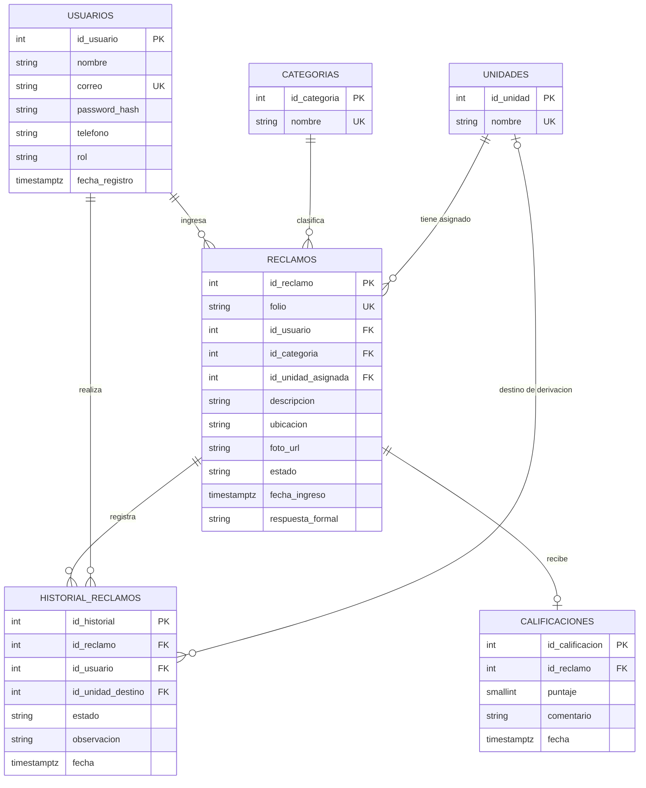

# MiSantoDomingo

<div align="center">
  
  <p><b>Plataforma Municipal de Atención y Seguimiento de Reclamos Vecinales</b></p>
</div>

---


## Índice
1. [Identificación de los integrantes del equipo y sus roles](#1-identificación-de-los-integrantes-del-equipo-y-sus-roles)
2. [Distribución de responsabilidades](#2-distribución-de-responsabilidades)
3. [Descripción general del sistema y problema que aborda](#3-descripción-general-del-sistema-y-problema-que-aborda)
4. [Principales funcionalidades](#4-principales-funcionalidades)
5. [Tecnologías y herramientas utilizadas](#5-tecnologías-y-herramientas-utilizadas)
6. [Arquitectura y estructura del backend](#6-arquitectura-y-estructura-del-backend)
7. [Base de datos](#7-base-de-datos)
8. [Instrucciones de instalación y configuración](#8-instrucciones-de-instalación-y-configuración)
9. [Variables de entorno](#9-variables-de-entorno)
10. [Instrucciones de ejecución y uso](#10-instrucciones-de-ejecución-y-uso)
11. [Documentación de la API REST](#11-documentación-de-la-api-rest)
12. [Autenticación y roles (JWT)](#12-autenticación-y-roles-jwt)
13. [Seguridad y validaciones](#13-seguridad-y-validaciones)
14. [Pruebas funcionales](#14-pruebas-funcionales)
15. [Integración frontend y backend](#15-integración-frontend-y-backend)
16. [Gestión del proyecto y evidencia de contribuciones](#16-gestión-del-proyecto-y-evidencia-de-contribuciones)
17. [Enlaces](#17-enlaces)
18. [Bibliografía y uso de IA](#18-bibliografía-y-uso-de-ia)


---


## 1. Identificación de los integrantes del equipo y sus roles

**Sebastian Garay** - Arquitectura de Software, Desarrollo Frontend y Control de Calidad

**Benjamín Lazcano** - Líder de Requerimientos, Investigación y Documentación UX

**Vicente Olguin** - Diseño UI/UX y Prototipado Manual Figma (Versión Escritorio / Web)

**Ignacio Maureira** - Diseño UI/UX y Prototipado Manual Figma (Versión Móvil)

---


## 2. Distribución de responsabilidades

### 2.1. Sebastián Garay

Responsabilidad: 

Entregables:

### 2.2. Benjamin Lazcano

Responsabilidad: 

Entregables: 

### 2.3. Vicente Olguin

Responsabilidad: 

Entregables: 

### 2.4. Ignacio Maureira

Responsabilidad: 

Entregables: 


---


## 3. Descripción general del sistema y problema que aborda

### 3.1. Descripción general del sistema

**API REST** desarrollada con **Node.js**, **Express** y **PostgreSQL** que da soporte a la plataforma MiSantoDomingo. Este sistema reemplaza los servicios **MOCK** del frontend por datos reales y se encarga de:  

- **Registro e inicio de sesión**: Permite a los vecinos crear una cuenta e ingresar a la plataforma mediante un token **JWT**, que identifica el rol como vecino o admin.

- **Gestión de reclamos**: Permite ingresar reclamos con una fotografía opcional, generar un folio único para cada reclamo, actualizar el estado del reclamo, derivar el reclamo entre unidades municipales, registrar una respuesta formal al cerrar los reclamos y gestionar la cancelación de los reclamos.

- **Control de plazos**: Calcula el tiempo restante del plazo legal de 20 días para responder los reclamos e identifica los reclamos que ya se encuentran vencidos.

- **Historial de cambios**: Registra las modificaciones de estado de cada reclamo manteniendo la trazabilidad de la gestión.

- **Calificación ciudadana**: Permite que los usuarios califiquen la atención que recibieron en una escala de puntuación de 1 a 5 estrellas, evitando que un mismo usuario vote más de una vez.


### 3.2. Problema o necesidad que aborda


Tiempos de respuesta prolongados o falta de soluciones efectivas a los reclamos y
solicitudes que los ciudadanos ingresan al municipio, generando frustración.


### 3.3. Objetivos del proyecto


- Disponer de un canal ciudadano digital accesible para ingresar reclamos en menos de 3 minutos con obtención inmediata de comprobante único de folio.
  
- Garantizar la trazabilidad completa del ciclo de vida del reclamo tanto para el vecino como para los funcionarios municipales.
  
- Proporcionar al municipio una herramienta administrativa para medir tiempos de respuesta frente al plazo legal de 20 días y priorizar la gestión mediante indicadores **KPI**.


### 3.4. Objetivos específicos del backend


- Exponer la **API REST** con operaciones **GET**, **POST**, **PATCH** y **DELETE** sobre una base de datos relacional **PostgreSQL**, con respuestas **JSON** consistentes y códigos **HTTP** adecuados.

- Autenticar y autorizar a vecinos y funcionarios mediante **JWT**, restringiendo las acciones de gestión al rol administrador.

- Garantizar la integridad y trazabilidad de los datos mediante restricciones en la base datos, transacciones y un historial inmutable.


## 4. Principales funcionalidades

<!-- -->

### 4.1. Rol Vecino/Vecina

Los vecinos y vecinas pueden utilizar la plataforma para ingresar reclamos, consultar su estado y hacer seguimiento de su resolución. Las funcionalidades disponibles para este rol son las siguientes:
 
-  **Registro e inicio de sesión**: Permite crear una cuenta e ingresar a la plataforma. Al crearse una cuenta, el sistema automáticamente le asignara el rol de vecino.

-  **RF-01. Ingreso de reclamos**: Permite ingresar un reclamo indicando la categoría, descripción y ubicación, además de poder adjuntar una fotografía de forma opcional. Se aceptan imágenes en formato **JPEG**, **PNG** o **WebP**, con un tamaño máximo de 5 MB.

-  **RF-02. Generación de Folio**: Al ingresar un reclamo, el sistema genera un folio único con el formato SD-AAAA-XXXXXX, que permite identificarlo y consultarlo posteriormente.

- **RF-04. Seguimiento de plazos**: Permite conocer los días restantes del plazo legal de 20 días para la resolución del reclamo y verificar si este se encuentra vencido.

- **RF-05. Consulta de reclamos**: Permite revisar el listado de reclamos ingresados por el propio usuario, acceder al detalle de cada uno y consultar el historial de cambios del reclamo.

- **RF-09. Calificación del servicio**: Permite calificar con una puntuación de 1 a 5 estrellas a un reclamo que haya sido resuelto. **SOLO** la persona que ingresó el reclamo puede calificar y se admite solamente un voto.

- **Cancelación de reclamos**: Permite al vecino/vecina cancelar un reclamo propio mientras este reclamo se encuentre en el estado **"Pendiente"** cambiando el estado a **"Rechazado"**.

### 4.2. Rol Funcionario municipal (OIRS)

El funcionario municipal encargado de la OIRS puede acceder a los reclamos ingresados por los vecinos y gestionar su seguimiento hasta su resolución. Para ello, cuenta con las siguientes funcionalidades:
 
- **Inicio de sesión**: Permite ingresar a la plataforma con una cuenta que tenga asignado el rol admin.

- **RF-05. Consulta del historial**: Permite revisar el historial completo de cada reclamo, incluyendo los cambios realizados y el responsable de cada acción, lo que le facilita al administrador el seguimiento de su gestión.

- **RF-06. Consulta y filtrado de reclamos**: Permite visualizar todos los reclamos registrados en el sistema y filtrarlos por estado, categoría o unidad municipal. También permite buscar casos específicos mediante su folio o descripción.

- **RF-07. Derivación de reclamos**: Permite derivar un reclamo a otra unidad municipal para que sea gestionado por el área correspondiente. Para realizar la derivación es obligatorio indicar la unidad de destino y un motivo de la derivación.

- **RF-08. Gestión y cierre de reclamos**: Permite actualizar el estado de un reclamo durante su gestión y marcarlo como **"Resuelto"**, siempre que se ingrese una respuesta formal.

### 4.3. Acceso público (sin sesión)
 
- **RF-03. Consulta pública de reclamos**: Permite consultar un reclamo ingresando su número de folio. La información disponible incluye el estado actual del reclamo, la unidad municipal asignada, el plazo de respuesta, el historial de cambios y la calificación registrada.

- **Consulta de catálogos**: Permite acceder a los listados de categorías de reclamos y las unidades municipales que se encuentran disponibles actualmente en la plataforma.

- **Verificación del servidor**: Permite comprobar si el **backend** se encuentra operativo mediante el endpoint (`/api/health`).

---

## 5. Tecnologías y herramientas utilizadas

 
| Categoría | Tecnología | Versión |
|---|---|---|
| Lenguaje / Runtime | Node.js (módulos ES) | 18.11 o superior |
| Framework backend | Express | 4.19.2 |
| Base de datos relacional | PostgreSQL (administrada con pgAdmin) | |
| Acceso a datos | `pg` (consultas SQL parametrizadas, sin ORM) | 8.12.0 |
| Autenticación | JSON Web Token (`jsonwebtoken`) | 9.0.2 |
| Hash de contraseñas | `bcryptjs` | 2.4.3 |
| Carga de archivos | `multer` | 1.4.5-lts.1 |
| CORS | `cors` | 2.8.5 |
| Variables de entorno | `dotenv` | 16.4.5 |
| Validación de datos | Validaciones manuales en los controladores y restricciones `CHECK` en la base de datos | |
| Pruebas de API | Postman (escritorio) | |
| Control de versiones | Git y GitHub | |
 
---


## 6. Arquitectura y estructura del backend


El backend sigue una arquitectura en capas. Cada petición pasa por `app.js` (CORS y lectura de JSON), las **rutas** (`routes/`) que definen los endpoints, los **middlewares** (`middlewares/`) que verifican el JWT, el rol y la carga de archivos, y los **controladores** (`controllers/`), que contienen la lógica de negocio y ejecutan las consultas SQL sobre PostgreSQL a través de un pool de conexiones (`config/db.js`). Las operaciones que modifican varias tablas se ejecutan dentro de transacciones.


### 6.1. Estructura del proyecto


```
MiSantoDomingo/                 
├── database/
│   ├── schema.sql              # Tablas, restricciones, índices, trigger y catálogos
│   ├── 01_usuarios_prueba.sql  # Cuentas de demostración
│   └── 02_datos_prueba.sql     # Reclamos de prueba con historial
├── pruebas/
│   └── MiSantoDomingo.postman_collection.json
├── src/
│   ├── config/
│   │   └── db.js               # Pool de conexiones a PostgreSQL
│   ├── controllers/
│   │   ├── auth.controller.js      # Registro, login y perfil
│   │   ├── catalogos.controller.js # Categorías y unidades
│   │   └── reclamos.controller.js  # Ciclo de vida de los reclamos
│   ├── middlewares/
│   │   ├── auth.middleware.js      # verificarToken y soloAdmin
│   │   └── upload.middleware.js    # Carga de fotografías (Multer)
│   ├── routes/
│   │   ├── auth.routes.js
│   │   ├── catalogos.routes.js
│   │   └── reclamos.routes.js
│   └── app.js                  # Configuración de Express y montaje de rutas
├── uploads/                    # Fotografías subidas (se crea sola; ignorada por Git)
├── .env.example                # Plantilla de variables de entorno
├── .gitignore
├── package.json
└── server.js                   # Punto de entrada: levanta el servidor y verifica la BD
```


### 6.2. Diagrama de arquitectura


---

## 7. Base de Datos

### 7.1. Creación de la base

Crear en PostgreSQL (pgAdmin) una base de datos llamada `misantodomingo_db`

### 7.2. Scripts SQL y orden de ejecución

Los scripts están en la carpeta `database/` y **deben ejecutarse en este orden**
(Query Tool sobre `misantodomingo_db`, abrir el archivo y presionar F5):

| Orden | Archivo                  | Qué hace                                                                                         |
| :---- | :----------------------- | :----------------------------------------------------------------------------------------------- |
| 1     | `schema.sql`             | Crea las tablas, restricciones y los catálogos (6 categorías y 5 unidades). No incluye usuarios. |
| 2     | `01_usuarios_prueba.sql` | Crea las cuentas de demostración (vecino y funcionario OIRS).                                    |
| 3     | `02_datos_prueba.sql`    | Carga 3 reclamos de prueba con su historial.                                                     |

**Justificación de `01_usuarios_prueba.sql`:** el `schema.sql` solo crea la estructura
y los catálogos, pero ningún usuario. Sin usuarios no se puede iniciar sesión ni probar
las rutas protegidas, y `02_datos_prueba.sql` falla porque sus reclamos referencian a los
usuarios con id 1 y 2 (llaves foráneas). Este script deja la base lista solo con scripts
SQL, sin registrar usuarios a mano por la API. Las contraseñas se almacenan hasheadas con
bcrypt (no en texto plano).

### 7.3. Datos de prueba (`02_datos_prueba.sql`)

Permite validar en vivo los casos borde del sistema:
 
| Folio | Estado | Antigüedad | Caso que valida |
| :---- | :----- | :--------- | :-------------- |
| `SD-2026-000101` | Pendiente | 3 días | Reclamo reciente dentro de plazo |
| `SD-2026-000088` | Derivado | 26 días | Plazo legal de 20 días vencido y derivación a unidad |
| `SD-2026-000042` | Resuelto | 15 días | Reclamo con respuesta formal, listo para probar la calificación de 1 a 5 estrellas |
 
Cada reclamo incluye su registro en `historial_reclamos`.

### 7.4. Verificación

Ejecutar en el Query Tool:
 
```sql
SELECT folio, estado,
       CURRENT_DATE - fecha_ingreso::date AS dias_transcurridos
FROM reclamos
ORDER BY fecha_ingreso;
```
Deben aparecer 3 reclamos (26, 15 y 3 días).

### 7.5. Modelo relacional



### 7.6. Descripción de tablas

| Tabla | Descripción | Clave primaria | Claves foráneas |
|---|---|---|---|
| `usuarios` | Cuentas de vecinos y funcionarios OIRS | `id_usuario` | — |
| `categorias` | Catálogo de categorías de reclamo | `id_categoria` | — |
| `unidades` | Catálogo de unidades municipales | `id_unidad` | — |
| `reclamos` | Reclamos ingresados por los vecinos | `id_reclamo` | `id_usuario` → `usuarios`; `id_categoria` → `categorias`; `id_unidad_asignada` → `unidades` |
| `historial_reclamos` | Trazabilidad de cada cambio de estado y derivación (inmutable) | `id_historial` | `id_reclamo` → `reclamos`; `id_usuario` → `usuarios`; `id_unidad_destino` → `unidades` (opcional) |
| `calificaciones` | Calificación de 1 a 5 de un reclamo resuelto (voto único) | `id_calificacion` | `id_reclamo` → `reclamos` (único) |


### 7.7. Restricciones e integridad

| Tipo | Detalle |
|---|---|
| Claves primarias | Identificadores autogenerados (`GENERATED ALWAYS AS IDENTITY`) en todas las tablas |
| `NOT NULL` | Campos esenciales de cada tabla (nombre, correo, hash, folio, descripción, ubicación, estado, etc.) |
| `UNIQUE` | `usuarios.correo`, `reclamos.folio`, nombres de `categorias` y `unidades`, y `calificaciones.id_reclamo` (garantiza el voto único) |
| `CHECK` de dominio | `rol` solo `vecino` o `admin`; `estado` solo `Pendiente`, `En Revisión`, `Derivado`, `Resuelto` o `Rechazado`; `puntaje` entre 1 y 5; textos obligatorios sin espacios vacíos |
| `CHECK` de negocio | `resuelto_con_respuesta` (un reclamo resuelto exige respuesta formal); `derivacion_completa` (una derivación exige unidad de destino y observación); `destino_solo_derivacion` (solo las derivaciones llevan unidad de destino); `correo_normalizado` (correo en minúsculas y con formato válido) |
| Claves foráneas | Todas con `ON DELETE RESTRICT`: no se puede borrar un registro referenciado. No se define `ON UPDATE` (se usa el comportamiento por defecto, `NO ACTION`) |
| Trigger | `historial_inmutable` impide modificar o eliminar filas de `historial_reclamos` |
| Índices | Por usuario, categoría y unidad en `reclamos`, y por reclamo y fecha en `historial_reclamos` |
 
> **Aviso:** si las cuentas de demostración ya se crearon registrándolas por la API
> (`POST /api/auth/registro`), no ejecutar `01_usuarios_prueba.sql`, porque los
> correos ya existen y daría error de duplicado. Ese script es para bases nuevas.
 
---


## 8. Instrucciones de instalación y configuración

### 8.1. Requisitos previos

- Node.js: versión 18.11 o superior
- npm: versión 9.x o superior.
- PostgreSQL y pgAdmin instalados.
- Git: instalado en el sistema operativo.


### 8.2. Pasos de instalación

**1. Clonar el repositorio**

```bash
   git clone https://github.com/sebagarayn/MiSantoDomingo.git
```
 
**2. Entrar al directorio del proyecto**

```bash
   cd MiSantoDomingo
```
 
**3. Cambiar a la rama backend**

```bash
   git checkout backend
```
 
**4. Instalar las dependencias**

```bash
   npm install
```

## 9. Variables de entorno

El archivo `.env` se encuentra protegido y excluido del repositorio mediante `.gitignore` para cumplir con la rúbrica de no exponer credenciales ni secretos en GitHub.

Para configurar el entorno local, se debe copiar la plantilla de ejemplo:

- **En Windows PowerShell:**
  ```powershell
  Copy-Item .env.example .env
  ```
- **En Linux / macOS:**
  ```bash
  cp .env.example .env
  ```

| Variable     | Descripción                                              | Valor recomendado / Ejemplo                     |
| :----------- | :------------------------------------------------------- | :---------------------------------------------- |
| `PORT`       | Puerto local en el que escucha el servidor Express       | `3000`                                          |
| `PGHOST`     | Servidor o host de la base de datos PostgreSQL           | `localhost`                                     |
| `PGPORT`     | Puerto de conexión a PostgreSQL                          | `5432`                                          |
| `PGDATABASE` | Nombre de la base de datos relacional creada en pgAdmin  | `misantodomingo_db`                             |
| `PGUSER`     | Usuario administrador de PostgreSQL                      | `postgres`                                      |
| `PGPASSWORD` | Contraseña local configurada en pgAdmin / PostgreSQL     | _Tu contraseña local_                           |
| `JWT_SECRET` | Clave secreta para la firma y verificación de tokens JWT | `secreto_jwt_super_seguro_para_evaluacion_2026` |

> **Nota de Seguridad (Criterio 2.5):** La variable `JWT_SECRET` es estrictamente obligatoria. El servidor implementa validación al inicio (`Fail-Fast`); si la variable no existe en el archivo `.env`, el servidor aborta el arranque con un mensaje claro en la terminal para impedir la ejecución con secretos por defecto vulnerables.

---

## 10. Instrucciones de ejecución y uso

### 10.1. Levantar el servidor

```bash

```

Una vez iniciado, la API queda disponible en:

```

```

### 10.2. Cuentas de prueba

Cuentas de demostración sembradas mediante `database/01_usuarios_prueba.sql` y alineadas directamente con las proto-personas definidas para el proyecto:

| Rol                          | Nombre         | Correo Electrónico | Contraseña | Permisos y Capacidades                                                                                                                |
| :--------------------------- | :------------- | :----------------- | :--------- | :------------------------------------------------------------------------------------------------------------------------------------ |
| **Vecina (Ciudadana)**       | María González | `vecino@correo.cl` | `123456`   | Ingresar reclamos, consultar "Mis Reclamos", calificar con estrellas casos resueltos y cancelar reclamos propios en estado Pendiente. |
| **Funcionario OIRS (Admin)** | Felipe Pérez   | `admin@correo.cl`  | `123456`   | Acceso a bandeja general tabular, filtros combinados, derivación a unidades técnicas y cierre formal con respuesta oficial.           |

---

## 11. Documentación de la API REST

<!-- Documentar cada endpoint: metodo, ruta, parametro, autenticacion, respuesta esperada, y casos de error. y repetir el bloque de detalle por cada endpoint -->

### 11.1. Resumen de endpoints

| Método | Ruta | Descripción | Autenticación | Rol requerido |
| ------ | ---- | ----------- | ------------- | ------------- |
|        |      |             |               |               |
|        |      |             |               |               |
|        |      |             |               |               |
|        |      |             |               |               |

### 11.2. Detalle de endpoints

#### `MÉTODO /ruta`

- **Descripción:**
- **Autenticación:**
- **Parámetros / Body:**

```json

```

- **Respuesta exitosa (código):**

```json

```

- **Casos de error:**

| Código | Situación | Respuesta |
| ------ | --------- | --------- |
|        |           |           |

### 11.3. Códigos HTTP utilizados

| Código | Uso |
| ------ | --- |
| 200    |     |
| 201    |     |
| 400    |     |
| 401    |     |
| 403    |     |
| 404    |     |
| 500    |     |

---

## 12. Autenticación y roles (JWT)

### 12.1. Flujo de autenticación

1. **Credenciales:** El cliente envía `correo` y `password` al endpoint `POST /api/auth/login`.
2. **Validación:** El servidor busca el usuario en PostgreSQL y compara la contraseña contra el hash almacenado mediante `bcrypt.compare()`.
3. **Generación de Token:** Si las credenciales coinciden, se firma un token JWT con algoritmo HS256 utilizando la clave obligatoria `process.env.JWT_SECRET`.
4. **Almacenamiento y Envío:** El cliente almacena el token en `localStorage["msd_token"]` y lo adjunta en cada petición protegida mediante la cabecera `Authorization: Bearer <token>`.
5. **Middlewares de Control:**
   - `verificarToken`: Valida la firma del token y vigencia temporal.
   - `soloAdmin`: Verifica que `req.usuario.rol === 'admin'` antes de autorizar derivaciones o cierres formales.

### 12.2. Estructura del token (payload)

```json
{
  "id_usuario": 1,
  "nombre": "María González",
  "correo": "vecino@correo.cl",
  "rol": "vecino",
  "iat": 1792080000,
  "exp": 1792108800
}
```

### 12.3. Tiempo de expiración

Los tokens emitidos cuentan con una validez estricta de **8 horas** (`expiresIn: '8h'`).

### 12.4. Roles y permisos

| Rol                      | Endpoints / Acciones permitidas                                                                                                                                                                |
| :----------------------- | :--------------------------------------------------------------------------------------------------------------------------------------------------------------------------------------------- |
| **Vecino/Vecina**        | `POST /api/reclamos` (crear), `GET /api/reclamos` (solo sus propios reclamos), `DELETE /api/reclamos/:id` (cancelar pendiente), `POST /api/reclamos/:id/calificacion` (votar 1 a 5 estrellas). |
| **Funcionario OIRS**     | `GET /api/reclamos` (bandeja completa con filtros de estado/unidad), `PATCH /api/reclamos/:id/estado` (derivar casos a otras unidades y cerrar formalmente).                                   |
| **Público (Sin sesión)** | `GET /api/reclamos/folio/:folio` (consulta anónima de estado y trazabilidad), `GET /api/categorias`, `GET /api/unidades`, `POST /api/auth/login`, `POST /api/auth/registro`.                   |

---

## 13. Seguridad y validaciones

| Medida                                       | Implementación técnica en el sistema                                                                                                                                                                               |
| :------------------------------------------- | :----------------------------------------------------------------------------------------------------------------------------------------------------------------------------------------------------------------- |
| **Hash de contraseñas con bcrypt**           | Cifrado con `bcryptjs` y 10 rondas de salt antes de insertar en la base de datos. Ninguna contraseña se almacena ni viaja en texto plano.                                                                          |
| **Validación de entradas**                   | Sanitización de cadenas (`btrim()`), validación de longitud mínima de clave ($\ge$ 6 caracteres) y validación de tipos numéricos.                                                                                  |
| **Prevención de inyección SQL**              | 100% de las consultas a PostgreSQL utilizan consultas parametrizadas con marcadores de posición (`$1, $2, $3...`) mediante `pg.Pool`.                                                                              |
| **Manejo seguro de secretos (Criterio 2.5)** | Se eliminó cualquier valor por defecto (_fallback secret_) del código fuente. `JWT_SECRET` se lee exclusivamente desde `process.env`; si la variable no existe, el servidor se detiene de inmediato (_Fail-Fast_). |
| **Protección de rutas por rol**              | Middlewares `verificarToken` y `soloAdmin` que rechazan con `401 Unauthorized` peticiones anónimas y con `403 Forbidden` intentos de escalada de privilegios.                                                      |
| **Manejo de errores seguro**                 | Respuestas HTTP consistentes en formato JSON (`400`, `401`, `403`, `404`, `409`, `500`) sin filtrar trazas de la base de datos ni detalles internos de la infraestructura.                                         |

---

## 14. Pruebas funcionales

### 14.1. Herramienta utilizada

Postman (versión de escritorio), usada para probar los endpoints de la API REST
contra el servidor local en `http://localhost:3000`.

<!-- Postman o Insomnia -->

### 14.2. Colección de pruebas

```
pruebas/MiSantoDomingo.postman_collection.json
```

### 14.3. Evidencia

<!-- Capturas de los casos exitosos y casos de error -->
<!-- Captura de la prueba de login -->

---

## 15. Integración frontend y backend

<!-- AQUI FALTAN COSAS REVISAR, FALTA POR RELLENAR -->

- **Cliente HTTP utilizado (fetch / Axios):**
- **Manejo de JWT (almacenamiento e interceptores):**
- **Manejo de errores y sesiones:**
- **Flujos principales funcionando con datos reales:**
- **Servicios mock reemplazados (`auth.service.ts`, `report.service.ts`):**

---

## 16. Gestión del proyecto y evidencia de contribuciones

 <!-- AQUI TAMBIEN FALTA POR RELLENAR-->

- **Ramas utilizadas:** `frontend` y `backend`
- **Convención de commits:**
- **Evidencia de trabajo colaborativo:**

---

## 17. Enlaces

| Recurso                            | Enlace                                                                                               |
| ---------------------------------- | ---------------------------------------------------------------------------------------------------- |
| Repositorio GitHub                 | https://github.com/sebagarayn/MiSantoDomingo                                                         |
| Prototipo Figma (Web / Escritorio) | https://www.figma.com/design/g226BWBCK7VZ2fzl9aj8at/Sin-título?node-id=0-1&t=OWk7vIgmDlFjNYgl-1      |
| Prototipo Figma (Móvil)            | https://www.figma.com/design/APracKRLzJMMzqzsLFHSXx/Sin-t%C3%ADtulo?node-id=0-1&t=x8JV6gNCCvaOFn40-1 |
| Colección Postman / Insomnia       |                                                                                                      |

---

## 18. Bibliografía y uso de IA

- **BIBLIOGRAFÍA**

- **USO DE IA**

En el desarrollo de este trabajo se utilizó inteligencia artificial como una herramienta de apoyo: orientación en el diseño del código y su estructura, auditoría del código y clarificación de conceptos. Todo el código fue analizado, adaptado y validado por los autores.
