# MiSantoDomingo — Backend (API REST & Base de Datos)


**Plataforma Municipal de Atención y Seguimiento de Reclamos Vecinales**  
_Municipalidad de Santo Domingo — Región de Valparaíso_  
Proyecto académico de Ingeniería Web y Móvil — **Entrega Final** (Backend API REST, Base de Datos Relacional, Seguridad Avanzada, Servicio Externo y Docker)

---

## Índice

1. [Identificación de los integrantes del equipo y sus roles](#1-identificación-de-los-integrantes-del-equipo-y-sus-roles)
2. [Distribución de responsabilidades](#2-distribución-de-responsabilidades)
3. [Descripción general del sistema y problema que aborda](#3-descripción-general-del-sistema-y-problema-que-aborda)
4. [Principales funcionalidades](#4-principales-funcionalidades)
5. [Tecnologías y herramientas utilizadas](#5-tecnologías-y-herramientas-utilizadas)
6. [Arquitectura y estructura del backend](#6-arquitectura-y-estructura-del-backend)
7. [Base de datos](#7-base-de-datos)
8. [Instrucciones de instalación y configuración local](#8-instrucciones-de-instalación-y-configuración-local)
9. [Despliegue con Docker y Docker Compose](#9-despliegue-con-docker-y-docker-compose)
10. [Variables de entorno](#10-variables-de-entorno)
11. [Instrucciones de ejecución y uso](#11-instrucciones-de-ejecución-y-uso)
12. [Documentación de la API REST](#12-documentación-de-la-api-rest)
13. [Integración con servicio externo (Nominatim / OpenStreetMap)](#13-integración-con-servicio-externo-nominatim--openstreetmap)
14. [Autenticación y roles (JWT)](#14-autenticación-y-roles-jwt)
15. [Seguridad y validaciones](#15-seguridad-y-validaciones)
16. [Optimización de consultas y rendimiento](#16-optimización-de-consultas-y-rendimiento)
17. [Pruebas automatizadas y funcionales (Node Test Runner y Postman)](#17-pruebas-automatizadas-y-funcionales-node-test-runner-y-postman)
18. [Integración frontend y backend](#18-integración-frontend-y-backend)
19. [Trazabilidad de requerimientos y progreso entre entregas](#19-trazabilidad-de-requerimientos-y-progreso-entre-entregas)
20. [Gestión del proyecto y evidencia de contribuciones](#20-gestión-del-proyecto-y-evidencia-de-contribuciones)
21. [Enlaces](#21-enlaces)
22. [Bibliografía y uso de IA](#22-bibliografía-y-uso-de-ia)

---

## 1. Identificación de los integrantes del equipo y sus roles

**Sebastián Garay** (`sebagarayn`) — Arquitectura de Software, Seguridad de API, Base de Datos y Optimización

**Benjamín Lazcano** (`benjaminlazcanor-hub` / `lazcanobenjamin83-arch`) — Sistema de Notificaciones, Mejoras UI/UX, Accesibilidad y Documentación

**Vicente Olguín** (`Vichonoma`) — Contenedores Docker, CRUD de Catálogos y Almacenamiento Local

**Ignacio Maureira** (`IgnacioMaureira`) — Integración Frontend, Servicio Externo (Mapas/Geocodificación) y Pruebas Automatizadas

---

## 2. Distribución de responsabilidades

### 2.1. Sebastián Garay

- **Responsabilidad:** Seguridad avanzada de la API (EF3), integridad y arranque de base de datos, y optimización de consultas (EF4), consolidando la API REST base de la EP2.
- **Entregables:** Cabeceras HTTP con `helmet` (incluyendo política `cross-origin` para servir fotografías de `/uploads`), CORS restringido al origen del frontend, limitador de intentos fallidos (`express-rate-limit`, código `429`), unificación de respuestas de token inválido en `401`, validación en vivo del rol vigente desde PostgreSQL por clave primaria, verificación binaria de imágenes con Magic Bytes (`file-type`), sanitización contra XSS y validación estricta de puntajes (`Number.isInteger`) y filtros de dominio. Además, scripts SQL re-ejecutables, healthcheck real (`SELECT 1` con código `503`), paginación en `/api/reclamos`, compresión Gzip y análisis de rendimiento con `EXPLAIN ANALYZE`.

### 2.2. Benjamín Lazcano

- **Responsabilidad:** Sistema de notificaciones al vecino (EF1), trazabilidad y consolidación documental (sobre la base del diseño de scripts SQL de EP2).
- **Entregables:** Script `05_notificaciones.sql`, servicio de creación automática de avisos dentro de la misma transacción ACID de cambio de estado, endpoints `/api/notificaciones` con control de propiedad por usuario, tabla de trazabilidad y documentación de progreso entre entregas.

### 2.3. Vicente Olguín

- **Responsabilidad:** Contenerización con Docker (EF6) y administración dinámica de catálogos (EF1).
- **Entregables:** `Dockerfile` del backend (usuario no-root `node`, dependencias de producción y volumen para `uploads/`), `.dockerignore`, archivo `docker-compose.yml` para orquestar PostgreSQL + Backend + Frontend, y endpoints administrativos (`POST`, `PUT`, `DELETE`) para categorías y unidades con protección ante registros en uso (`409 Conflict`).

### 2.4. Ignacio Maureira

- **Responsabilidad:** Integración de servicio externo de geocodificación (EF5) y suite de pruebas automatizadas y funcionales.
- **Entregables:** Migración `04_agregar_coordenadas_reclamos.sql`, integración con la API pública de OpenStreetMap (Nominatim) mediante proxy en `/api/geocodificar` con cola de peticiones, caché en memoria y timeout de 5 segundos; ampliación de `tests/app.test.js` a 12 pruebas automatizadas con `supertest` y actualización de la colección Postman a 19 solicitudes con 81 aserciones `pm.test()`.

---

## 3. Descripción general del sistema y problema que aborda

### 3.1. Descripción general del sistema

**API REST** desarrollada con **Node.js**, **Express** y **PostgreSQL** que da soporte a la plataforma **MiSantoDomingo**. Este sistema reemplaza cualquier dato simulado por persistencia relacional real y se encarga de:

- **Registro e inicio de sesión:** permite a los vecinos crear una cuenta e ingresar a la plataforma mediante un token **JWT**, revalidando su rol vigente (`vecino` o `admin`) directamente en la base de datos.
- **Gestión completa de reclamos:** permite ingresar reclamos con una fotografía opcional (validada por Magic Bytes) y coordenadas geográficas, generar un folio único para cada reclamo, actualizar el estado, derivar entre unidades municipales, registrar una respuesta formal al cerrar los casos, editar los datos mientras está pendiente y gestionar su cancelación lógica.
- **Control de plazos:** calcula el tiempo restante del plazo legal de 20 días corridos para responder los reclamos e identifica los que ya se encuentran vencidos.
- **Historial inmutable y notificaciones:** registra las modificaciones de estado de cada reclamo protegido por trigger en PostgreSQL y genera avisos automáticos para el vecino dentro de la misma transacción.
- **Calificación ciudadana:** permite evaluar la atención recibida en una escala entera de 1 a 5 estrellas, garantizando un único voto por reclamo resuelto.
- **Catálogos dinámicos y geocodificación:** permite administrar categorías y unidades municipales desde el rol administrador, y traducir direcciones/coordenadas dentro de Santo Domingo mediante Nominatim.

### 3.2. Problema o necesidad que aborda

Tiempos de respuesta prolongados o falta de soluciones efectivas a los reclamos y solicitudes que los ciudadanos ingresan al municipio, generando frustración y falta de trazabilidad entre unidades municipales.

> La justificación demográfica completa (Censo INE 2017–2024) y la caracterización de usuarios (proto-personas) se encuentran en el `README.md` de la rama `frontend`.

### 3.3. Objetivos del proyecto

- Disponer de un canal ciudadano digital accesible para ingresar reclamos en menos de 3 minutos con obtención inmediata de comprobante único de folio.
- Garantizar la trazabilidad completa del ciclo de vida del reclamo tanto para el vecino como para los funcionarios municipales.
- Proporcionar al municipio una herramienta administrativa para medir tiempos de respuesta frente al plazo legal de 20 días y priorizar la gestión mediante indicadores **KPI**.

### 3.4. Objetivos específicos del backend

- Exponer la **API REST** con operaciones **GET**, **POST**, **PUT**, **PATCH** y **DELETE** sobre **PostgreSQL**, con respuestas **JSON** consistentes, paginación y códigos **HTTP** adecuados.
- Autenticar y autorizar a vecinos y funcionarios mediante **JWT** con revalidación en base de datos, protegiendo las rutas contra fuerza bruta, XSS, inyección SQL y archivos maliciosos.
- Garantizar la integridad y trazabilidad de los datos mediante restricciones `CHECK`, transacciones ACID y un historial inmutable.
- Orquestar el despliegue reproducible de base de datos, backend y frontend mediante **Docker** y **Docker Compose**.

---

## 4. Principales funcionalidades

### 4.1. Rol Vecino/Vecina

- **Registro e inicio de sesión:** permite crear una cuenta (rol `vecino` asignado automáticamente) e ingresar a la plataforma.
- **RF-01. Ingreso de reclamos:** categoría, descripción (máx. 500 caracteres), ubicación, coordenadas opcionales (`latitud`/`longitud`) y fotografía opcional (`JPEG`, `PNG` o `WebP`, máx. 5 MB validada por Magic Bytes).
- **RF-02. Generación de folio:** genera un folio único con formato `SD-AAAA-XXXXXX`.
- **RF-04. Seguimiento de plazos:** informa los días restantes del plazo legal de 20 días y si el reclamo se encuentra vencido.
- **RF-05. Consulta de reclamos y notificaciones:** listado paginado de reclamos propios, detalle con historial de cambios y consulta/lectura de notificaciones de cambio de estado.
- **RF-09. Calificación del servicio:** permite calificar con un entero de 1 a 5 estrellas un reclamo propio que haya sido `Resuelto` (voto único).
- **Edición y cancelación de reclamos:** permite modificar (`PUT`) o anular lógicamente (`DELETE`, pasando a `Rechazado`) reclamos propios mientras sigan en estado `Pendiente`.

### 4.2. Rol Funcionario municipal (OIRS / Admin)

- **Inicio de sesión:** acceso con cuenta con rol `admin` verificado en PostgreSQL.
- **RF-05. Consulta del historial:** revisión cronológica completa y responsable de cada transición.
- **RF-06. Consulta y filtrado de reclamos:** bandeja paginada de todos los reclamos filtrable por estado, categoría, unidad municipal y texto libre.
- **RF-07. Derivación de reclamos:** traspaso obligatorio con unidad de destino y observación, creando historial y notificación transaccional.
- **RF-08. Gestión y cierre de reclamos:** actualización de estado o cierre como `Resuelto` exigiendo respuesta formal obligatoria.
- **Administración de catálogos:** CRUD completo (`POST`, `PUT`, `DELETE`) sobre categorías y unidades municipales, bloqueando con `409` la modificación de `OIRS Central` o registros en uso.

### 4.3. Acceso público (sin sesión)

- **RF-03. Consulta pública de reclamos:** seguimiento anónimo por número de folio (`GET /api/reclamos/folio/:folio`).
- **Consulta de catálogos y geocodificación:** lectura de categorías, unidades disponibles y consulta de coordenadas/direcciones en Santo Domingo.
- **Verificación del servidor:** estado de la API y conexión real a PostgreSQL (`GET /api/health`).

---

## 5. Tecnologías y herramientas utilizadas

| Categoría                      | Tecnología                                   | Versión / Detalle                                                 |
| ------------------------------ | -------------------------------------------- | ----------------------------------------------------------------- |
| Lenguaje / Runtime             | Node.js (ES Modules)                         | v24 en Docker / v18.11 o superior                                 |
| Framework backend              | Express                                      | `4.19.2`                                                          |
| Base de datos relacional       | PostgreSQL (administrada con pgAdmin)        | `16` (`postgres:16-alpine` en Docker)                             |
| Acceso a datos                 | `pg` (consultas SQL parametrizadas, sin ORM) | `8.12.0`                                                          |
| Autenticación                  | JSON Web Token (`jsonwebtoken`)              | `9.0.2`                                                           |
| Hash de contraseñas            | `bcryptjs`                                   | `2.4.3`                                                           |
| Seguridad HTTP y Rate Limit    | `helmet`, `cors`, `express-rate-limit`       | Cabeceras seguras, origen único y código `429`                    |
| Carga y validación de archivos | `multer`, `file-type`                        | Límite 5 MB + verificación binaria Magic Bytes                    |
| Optimización                   | `compression`                                | Compresión Gzip HTTP                                              |
| Variables de entorno           | `dotenv`                                     | `16.4.5`                                                          |
| Servicio Externo               | OpenStreetMap (Nominatim)                    | Geocodificación directa e inversa vía `fetch` nativo              |
| Pruebas automatizadas y API    | `node --test`, `supertest`, Postman          | 12 tests automatizados + Colección v2.1 (19 reqs / 81 aserciones) |
| Contenedores                   | Docker y Docker Compose                      | Despliegue local de DB, API y Frontend                            |
| Control de versiones           | Git y GitHub                                 | Ramas `backend` y `frontend`                                      |

---

## 6. Arquitectura y estructura del backend

El backend sigue una arquitectura en tres capas. Cada petición atraviesa `app.js` (`helmet`, `compression`, `cors`, `express.json()`), las **rutas** (`routes/`) y los **middlewares** (`middlewares/`), que validan límite de intentos, JWT con rol vigente en BD y archivos por Magic Bytes. Luego actúan:

- **Controladores (`controllers/`):** capa HTTP. Validan entradas (obligatoriedad, tipos, largos, ausencia de etiquetas HTML/XSS, filtros válidos, puntaje entero y rango de coordenadas) y responden con el código HTTP correspondiente.
- **Servicios (`services/`):** capa de datos e integración. Ejecutan SQL parametrizado mediante `pg.Pool`, coordinan transacciones ACID (`BEGIN`, `COMMIT`, `ROLLBACK`) con bloqueo de fila (`FOR UPDATE`), y consultan el servicio externo Nominatim.

Al final de `app.js`, los manejadores globales capturan JSON malformado (`400`), errores de Multer (`400`), errores de integridad de PostgreSQL (`400`), rutas inexistentes (`404`) y fallos imprevistos (`500`) en formato JSON uniforme sin exponer trazas internas.

### 6.1. Estructura del proyecto

```text
MiSantoDomingo-backend/                     # rama backend
├── database/
│   ├── 00_crear_base.sql                   # Crea la base de datos misantodomingo_db (uso local)
│   ├── schema.sql                          # Limpieza + tablas, restricciones, índices, trigger y catálogos
│   ├── 01_usuarios_prueba.sql              # Cuentas de demostración (vecino y admin)
│   ├── 02_datos_prueba.sql                 # 3 reclamos iniciales con subconsultas dinámicas (sin IDs fijos)
│   ├── 03_optimizacion_indices.sql         # Índices compuestos y prueba EXPLAIN ANALYZE
│   ├── 04_agregar_coordenadas_reclamos.sql # Columnas latitud y longitud con CHECK geográfico
│   └── 05_notificaciones.sql               # Tabla notificaciones e índice compuesto
├── pruebas/
│   ├── MiSantoDomingo.postman_collection.json # Colección Postman v2.1 (19 solicitudes, 81 pm.test)
│   └── capturas/                           # Evidencia de las pruebas en Postman (01 a 19)
├── src/
│   ├── config/
│   │   └── db.js                           # Pool de conexiones a PostgreSQL
│   ├── controllers/
│   │   ├── auth.controller.js              # Validación y respuestas de sesión
│   │   ├── catalogos.controller.js         # Lectura con ETag y CRUD administrativo de catálogos
│   │   ├── geocodificacion.controller.js   # Búsqueda directa e inversa de ubicaciones
│   │   ├── notificaciones.controller.js    # Listado y marcado de lectura por usuario
│   │   └── reclamos.controller.js          # Controladores del ciclo de vida del reclamo
│   ├── services/
│   │   ├── auth.service.js                 # Consultas SQL y lógica de usuarios
│   │   ├── catalogos.service.js            # Consultas SQL de categorías y unidades
│   │   ├── geocodificacion.service.js      # Proxy Nominatim: cola 1.1s, caché Map, timeout 5s
│   │   ├── notificaciones.service.js       # Creación transaccional y consulta de avisos
│   │   └── reclamos.service.js             # Transacciones SQL, paginación y estados
│   ├── middlewares/
│   │   ├── auth.middleware.js              # verificarToken (401 + rol vigente en BD) y soloAdmin (403)
│   │   └── upload.middleware.js            # Carga de fotografías (Multer) + validarMagicBytes (file-type)
│   ├── routes/
│   │   ├── auth.routes.js                  # Incluye authLimiter (429 tras 5 intentos fallidos)
│   │   ├── catalogos.routes.js
│   │   ├── geocodificacion.routes.js
│   │   ├── notificaciones.routes.js
│   │   └── reclamos.routes.js
│   ├── utils/
│   │   └── validaciones.js                 # esIdValido, badRequest, validarCuerpoCatalogo
│   └── app.js                              # Configuración Express, Helmet, Compression, CORS y errores
├── tests/
│   └── app.test.js                         # 12 pruebas automatizadas con node --test y supertest
├── uploads/                                # Fotografías subidas (ignorado por Git; volumen en Docker)
├── .dockerignore
├── .env.example                            # Plantilla de variables de entorno
├── .gitignore
├── Dockerfile                              # Contenedor Node 24 slim con usuario no-root
├── docker-compose.yml                      # Orquestación de db + backend + frontend
├── package.json
├── package-lock.json
├── README.md
└── server.js                               # Validación Fail-Fast de JWT_SECRET y PostgreSQL al iniciar
```

### 6.2. Diagrama de arquitectura

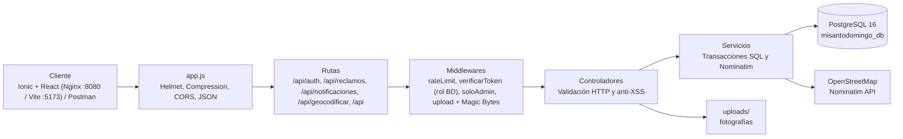

---

## 7. Base de Datos

### 7.1. Creación de la base

La base de datos se llama `misantodomingo_db`. En instalación local manual se crea ejecutando el script `database/00_crear_base.sql` conectado a la base `postgres` (Query Tool sobre `postgres`, abrir el archivo y presionar F5). En Docker, la crea automáticamente la variable `POSTGRES_DB`.

### 7.2. Scripts SQL y orden de ejecución

Todos los scripts en `database/` son **100% re-ejecutables**: `schema.sql` incluye `DROP ... IF EXISTS CASCADE`, los seeds usan `ON CONFLICT` / limpieza preventiva y las migraciones emplean `IF NOT EXISTS`. En instalación manual deben ejecutarse sobre `misantodomingo_db` en este orden:

| Orden | Archivo                               | Qué hace                                                                                              |
| :---: | ------------------------------------- | ----------------------------------------------------------------------------------------------------- |
|   1   | `00_crear_base.sql`                   | Crea la base de datos `misantodomingo_db` (solo para Postgres local; no se usa en Docker).            |
|   2   | `schema.sql`                          | Limpia y crea tablas base, restricciones, índices, trigger de inmutabilidad y catálogos iniciales.    |
|   3   | `01_usuarios_prueba.sql`              | Crea las cuentas de demostración (`vecino@correo.cl` y `admin@correo.cl`) con hash bcrypt.            |
|   4   | `02_datos_prueba.sql`                 | Carga 3 reclamos de prueba con historial usando **subconsultas por correo y nombre** (sin IDs fijos). |
|   5   | `03_optimizacion_indices.sql`         | Crea índices adicionales de estado/fecha y ejecuta consulta de medición `EXPLAIN ANALYZE`.            |
|   6   | `04_agregar_coordenadas_reclamos.sql` | Agrega columnas `latitud` y `longitud` a `reclamos` con sus restricciones `CHECK`.                    |
|   7   | `05_notificaciones.sql`               | Crea la tabla `notificaciones` y su índice compuesto para consultas por usuario y estado de lectura.  |

### 7.3. Datos de prueba (`02_datos_prueba.sql`)

Permite validar en vivo los casos borde del sistema:

| Folio            | Estado    | Antigüedad | Caso que valida                                                                           |
| :--------------- | :-------- | :--------- | :---------------------------------------------------------------------------------------- |
| `SD-2026-000101` | Pendiente | 3 días     | Reclamo reciente dentro de plazo                                                          |
| `SD-2026-000088` | Derivado  | 26 días    | Plazo legal de 20 días vencido y derivación a unidad                                      |
| `SD-2026-000042` | Resuelto  | 15 días    | Reclamo con respuesta formal, listo para probar calificación y cálculo promedio (10 días) |

### 7.4. Verificación

Ejecutar en el Query Tool:

```sql
SELECT folio, estado,
       CURRENT_DATE - fecha_ingreso::date AS dias_transcurridos
FROM reclamos
ORDER BY fecha_ingreso;
```

Deben aparecer 3 reclamos (26, 15 y 3 días).

### 7.5. Modelo relacional

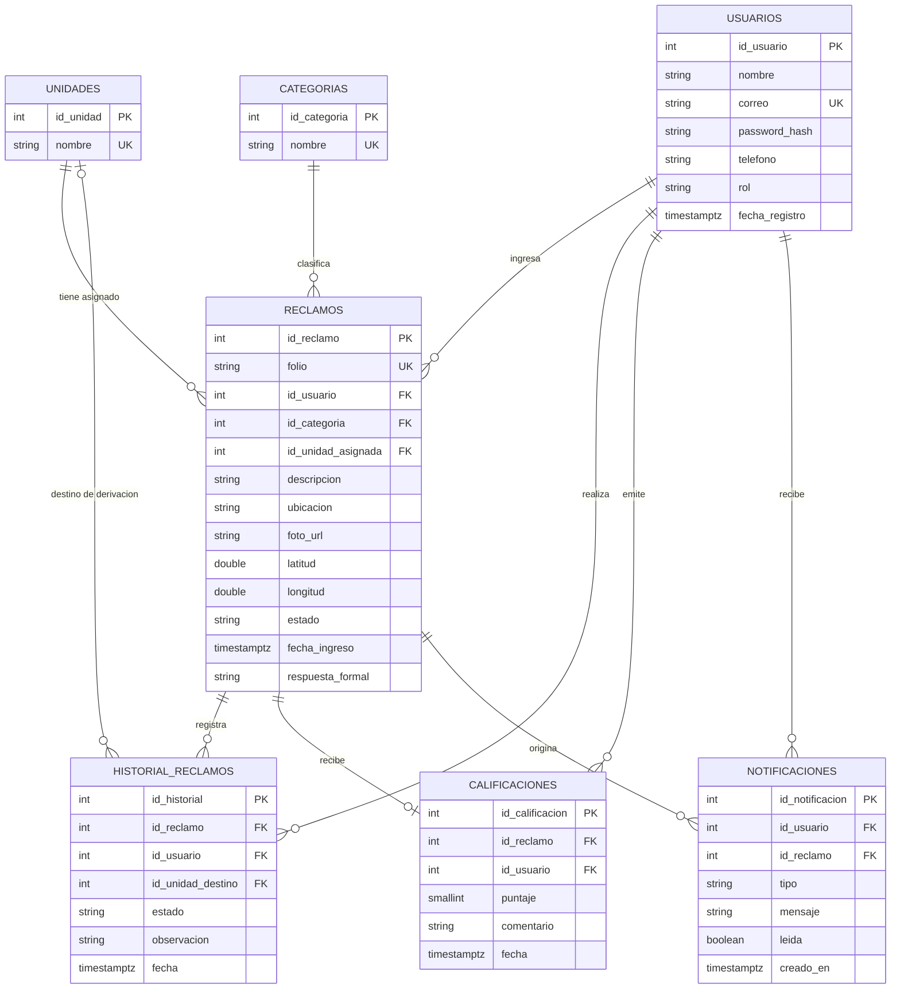

### 7.6. Descripción de tablas

| Tabla                | Descripción                                                    | Clave primaria    | Claves foráneas                                                                                   |
| -------------------- | -------------------------------------------------------------- | ----------------- | ------------------------------------------------------------------------------------------------- |
| `usuarios`           | Cuentas de vecinos y funcionarios OIRS                         | `id_usuario`      | —                                                                                                 |
| `categorias`         | Catálogo editable de categorías de reclamo                     | `id_categoria`    | —                                                                                                 |
| `unidades`           | Catálogo editable de unidades municipales                      | `id_unidad`       | —                                                                                                 |
| `reclamos`           | Reclamos ingresados, ubicación, coordenadas y fotografía       | `id_reclamo`      | `id_usuario` → `usuarios`; `id_categoria` → `categorias`; `id_unidad_asignada` → `unidades`       |
| `historial_reclamos` | Trazabilidad de cada cambio de estado y derivación (inmutable) | `id_historial`    | `id_reclamo` → `reclamos`; `id_usuario` → `usuarios`; `id_unidad_destino` → `unidades` (opcional) |
| `calificaciones`     | Calificación de 1 a 5 de un reclamo resuelto (voto único)      | `id_calificacion` | `id_reclamo` → `reclamos` (único); `id_usuario` → `usuarios`                                      |
| `notificaciones`     | Avisos al vecino generados ante cambios de estado              | `id_notificacion` | `id_usuario` → `usuarios`; `id_reclamo` → `reclamos`                                              |

### 7.7. Restricciones e integridad

| Tipo               | Detalle                                                                                                                                                                                                                                                                                      |
| ------------------ | -------------------------------------------------------------------------------------------------------------------------------------------------------------------------------------------------------------------------------------------------------------------------------------------- |
| Claves primarias   | Identificadores autogenerados (`GENERATED ALWAYS AS IDENTITY`) en todas las tablas                                                                                                                                                                                                           |
| `NOT NULL`         | Campos esenciales de cada tabla (nombre, correo, hash, folio, descripción, ubicación, estado, mensaje, etc.)                                                                                                                                                                                 |
| `UNIQUE`           | `usuarios.correo`, `reclamos.folio`, nombres de `categorias` y `unidades`, y `calificaciones.id_reclamo` (garantiza el voto único)                                                                                                                                                           |
| `CHECK` de dominio | `rol` (`vecino` o `admin`); `estado` (`Pendiente`, `En Revisión`, `Derivado`, `Resuelto` o `Rechazado`); `puntaje` entre 1 y 5; `latitud` entre `-90` y `90`; `longitud` entre `-180` y `180`; `tipo` de notificación (`cambio_estado`); textos obligatorios sin espacios vacíos (`btrim()`) |
| `CHECK` de negocio | `resuelto_con_respuesta` (exige respuesta formal al resolver); `derivacion_completa` (exige unidad de destino y observación al derivar); `destino_solo_derivacion` (solo derivaciones llevan unidad de destino); `correo_normalizado` (correo en minúsculas y formato válido)                |
| Claves foráneas    | Todas con `ON DELETE RESTRICT`: no se puede borrar un registro referenciado                                                                                                                                                                                                                  |
| Trigger            | `historial_inmutable` impide `UPDATE` o `DELETE` sobre `historial_reclamos`                                                                                                                                                                                                                  |
| Índices            | Índices por usuario, categoría, unidad, estado, fecha y compuesto `(estado, id_categoria, fecha_ingreso DESC)` en `reclamos`, más índices en `calificaciones`, `historial_reclamos` y `notificaciones`                                                                                       |

---

## 8. Instrucciones de instalación y configuración local

> Para ejecutar todo el sistema en contenedores sin instalar PostgreSQL localmente, pasa directo a la [Sección 9: Despliegue con Docker y Docker Compose](#9-despliegue-con-docker-y-docker-compose).

### 8.1. Requisitos previos

- **Node.js:** versión 18.11 o superior (probado en Node 24 LTS).
- **npm:** versión 9.x o superior.
- **PostgreSQL 16 y pgAdmin 4:** instalados y con el servicio en ejecución.
- **Git** y **Postman** (opcional para pruebas de colección).

### 8.2. Pasos de instalación

**Paso 1. Clonar la rama `backend` e instalar dependencias**

```bash
git clone -b backend https://github.com/sebagarayn/MiSantoDomingo.git MiSantoDomingo-backend
cd MiSantoDomingo-backend
npm install
```

**Paso 2. Crear la base de datos** _(pgAdmin 4)_

1. Conectarse al servidor de PostgreSQL.
2. Clic derecho sobre la base **postgres** → **Query Tool**.
3. Abrir el archivo `database/00_crear_base.sql` y presionar **F5**. Crea la base `misantodomingo_db`.
4. Actualizar el árbol (**Databases** → **Refresh**) y verificar `misantodomingo_db`.

**Paso 3. Crear las tablas y cargar los datos** _(pgAdmin 4)_

1. En el árbol de pgAdmin, hacer clic derecho sobre **`misantodomingo_db`** → **Query Tool**.
2. Abrir y ejecutar con **F5** los scripts de `database/` en este orden exacto:
   1. `schema.sql`
   2. `01_usuarios_prueba.sql`
   3. `02_datos_prueba.sql`
   4. `03_optimizacion_indices.sql`
   5. `04_agregar_coordenadas_reclamos.sql`
   6. `05_notificaciones.sql`

**Paso 4. Configurar variables de entorno**

```powershell
Copy-Item .env.example .env
```

Editar `.env` completando `PGPASSWORD`, `JWT_SECRET` (mínimo 32 caracteres aleatorios, distinto a ejemplos por defecto), `FRONTEND_URL=http://localhost:5173`, `NOMINATIM_URL` y `NOMINATIM_CONTACT`.

**Paso 5. Comprobar el arranque**

```bash
npm run dev
```

Debe mostrar la confirmación de conexión a PostgreSQL y quedar escuchando en `http://localhost:3000`. Abrir `http://localhost:3000/api/health` para comprobar estado `200 OK`.

---

## 9. Despliegue con Docker y Docker Compose

El sistema incluye `Dockerfile` para el backend (`node:24-bookworm-slim` con usuario no-root `node`), `Dockerfile` multietapa para el frontend (`Vite` + `nginx:stable-alpine`) y `docker-compose.yml` para orquestar **PostgreSQL 16 + Backend + Frontend**.

### 9.1. Requisitos previos

- **Docker Desktop** instalado y en ejecución.

### 9.2. Pasos para levantar los contenedores

1. Clonar ambas ramas en carpetas hermanas dentro de un mismo directorio:
   ```bash
   git clone -b backend https://github.com/sebagarayn/MiSantoDomingo.git MiSantoDomingo-backend
   git clone -b frontend https://github.com/sebagarayn/MiSantoDomingo.git MiSantoDomingo
   ```
2. Entrar a la carpeta del backend (asegurando que no haya otro servidor usando los puertos `3000`, `8080` o `5433`):
   ```bash
   cd MiSantoDomingo-backend
   ```
3. _(Opcional)_ Crear `.env` desde `.env.example` si se desean personalizar credenciales; de lo contrario, `docker-compose.yml` incluye valores seguros por defecto para el despliegue local.
4. Construir y levantar los 3 contenedores:
   ```bash
   docker compose up --build
   ```
5. Comprobar en otra terminal que `db` aparece `healthy` y todos los servicios están arriba:
   ```bash
   docker compose ps
   ```

### 9.3. Accesos y volúmenes

- **Frontend web/móvil (Nginx):** `http://localhost:8080`
- **API Backend (Express):** `http://localhost:3000/api/health`
- **PostgreSQL 16 (host):** puerto `5433` (evita conflictos con PostgreSQL local en `5432`; entre contenedores se comunican en `db:5432`).
- **Volúmenes persistentes:** `pg_data` (base de datos) y `uploads_data` (fotografías en `/app/uploads`).
- **Inicialización automática:** al partir con el volumen `pg_data` vacío, Postgres ejecuta automáticamente los scripts montados de `00_schema.sql` hasta `05_notificaciones.sql`.
- **Detener los contenedores:** `docker compose down` (conserva volúmenes) o `docker compose down -v` (borra volúmenes para reiniciar desde cero).

---

## 10. Variables de entorno

El archivo `.env` se encuentra excluido del repositorio mediante `.gitignore`. La plantilla de referencia está en `.env.example`:

| Variable              | Descripción                                                | Valor recomendado / Ejemplo                              |
| :-------------------- | :--------------------------------------------------------- | :------------------------------------------------------- |
| `PORT`                | Puerto local en el que escucha Express                     | `3000`                                                   |
| `PGHOST`              | Servidor o host de PostgreSQL (`db` dentro de Docker)      | `localhost`                                              |
| `PGPORT`              | Puerto de conexión a PostgreSQL                            | `5432`                                                   |
| `PGDATABASE`          | Nombre de la base de datos relacional                      | `misantodomingo_db`                                      |
| `PGUSER`              | Usuario de PostgreSQL                                      | `postgres`                                               |
| `PGPASSWORD`          | Contraseña local de PostgreSQL                             | _Tu contraseña local_                                    |
| `JWT_SECRET`          | Clave secreta obligatoria para firma y verificación de JWT | _Cadena larga y aleatoria (no usar valores por defecto)_ |
| `FRONTEND_URL`        | Origen permitido en CORS en desarrollo local               | `http://localhost:5173`                                  |
| `DOCKER_FRONTEND_URL` | Origen permitido en CORS al ejecutar tras Nginx Docker     | `http://localhost:8080`                                  |
| `NOMINATIM_URL`       | URL base del servicio externo de geocodificación           | `https://nominatim.openstreetmap.org`                    |
| `NOMINATIM_CONTACT`   | Correo enviado en la cabecera `User-Agent` hacia Nominatim | `contacto@ejemplo.cl`                                    |

> **Validación Fail-Fast:** al iniciar `server.js`, el servidor verifica que `JWT_SECRET` esté definido y no sea un marcador inseguro (`"clave_secreta"`, `"tu_secreto_aqui"`), y ejecuta `SELECT NOW()` en PostgreSQL; si falla cualquiera de los dos, termina el arranque inmediatamente con `process.exit(1)`.

---

## 11. Instrucciones de ejecución y uso

### 11.1. Levantar el servidor

```bash
npm run dev     # desarrollo, con reinicio automático (node --watch)
npm start       # producción
npm test        # ejecuta las 12 pruebas automatizadas (node --test)
```

### 11.2. Cuentas de demostración

Cuentas creadas con `database/01_usuarios_prueba.sql` y alineadas con las proto-personas definidas para el proyecto:

| Rol                          | Nombre         | Correo electrónico | Contraseña | Permisos y capacidades                                                                                                             |
| :--------------------------- | :------------- | :----------------- | :--------- | :--------------------------------------------------------------------------------------------------------------------------------- |
| **Vecina (ciudadana)**       | Maria Gonzalez | `vecino@correo.cl` | `123456`   | Ingresar reclamos con foto y mapa, consultar "Mis Reclamos", ver notificaciones, editar/cancelar pendientes y calificar resueltos. |
| **Funcionario OIRS (admin)** | Felipe Perez   | `admin@correo.cl`  | `123456`   | Bandeja general con filtros, derivación a unidades técnicas, cierre formal con respuesta oficial y gestión de catálogos.           |

> El rol `admin` no puede obtenerse desde `/api/auth/registro`; solo se asigna directamente en PostgreSQL.

### 11.3. Levantar el frontend asociado (desarrollo manual)

En otra terminal, dentro de la carpeta hermana `MiSantoDomingo` (rama `frontend`):

```bash
npm install
npm run dev
```

Se abrirá en `http://localhost:5173` consumiendo la API en `http://localhost:3000/api`.

---

## 12. Documentación de la API REST

URL base: `http://localhost:3000`. Todas las respuestas son JSON con el campo `ok` (`true` o `false`) y, en los errores, un `mensaje`. Las rutas protegidas requieren la cabecera `Authorization: Bearer <token>`.

### 12.1. Resumen de endpoints

| Método   | Ruta                             | Descripción                                                             | Autenticación | Rol requerido  |
| -------- | -------------------------------- | ----------------------------------------------------------------------- | ------------- | -------------- |
| `GET`    | `/api/health`                    | Verifica API y ejecuta `SELECT 1` en PostgreSQL (`200` / `503`)         | No            | Público        |
| `POST`   | `/api/auth/registro`             | Registra un nuevo vecino (con Rate Limit)                               | No            | Público        |
| `POST`   | `/api/auth/login`                | Inicia sesión y entrega el token JWT (con Rate Limit)                   | No            | Público        |
| `GET`    | `/api/auth/perfil`               | Devuelve los datos vigentes del usuario autenticado                     | Sí            | Cualquiera     |
| `GET`    | `/api/categorias`                | Lista las categorías de reclamo (`Cache-Control: no-cache`, ETag)       | No            | Público        |
| `POST`   | `/api/categorias`                | Crea una nueva categoría                                                | Sí            | Admin          |
| `PUT`    | `/api/categorias/:id`            | Actualiza una categoría existente                                       | Sí            | Admin          |
| `DELETE` | `/api/categorias/:id`            | Elimina categoría (`409` si tiene reclamos asociados)                   | Sí            | Admin          |
| `GET`    | `/api/unidades`                  | Lista las unidades municipales (`Cache-Control: no-cache`, ETag)        | No            | Público        |
| `POST`   | `/api/unidades`                  | Crea una nueva unidad municipal                                         | Sí            | Admin          |
| `PUT`    | `/api/unidades/:id`              | Renombra unidad (`409` si es `OIRS Central`)                            | Sí            | Admin          |
| `DELETE` | `/api/unidades/:id`              | Elimina unidad (`409` si está en uso o es `OIRS Central`)               | Sí            | Admin          |
| `GET`    | `/api/geocodificar`              | Geocodificación directa (`?q=`) en Santo Domingo vía Nominatim          | No            | Público        |
| `GET`    | `/api/geocodificar/inversa`      | Geocodificación inversa (`?lat=&lng=`) vía Nominatim                    | No            | Público        |
| `GET`    | `/api/reclamos/folio/:folio`     | Consulta pública de un reclamo por folio                                | No            | Público        |
| `GET`    | `/api/reclamos`                  | Lista paginada (`?pagina=&limite=`) con filtros validados               | Sí            | Vecino / Admin |
| `POST`   | `/api/reclamos`                  | Ingresa reclamo con coordenadas y foto opcional (`multipart/form-data`) | Sí            | Autenticado    |
| `GET`    | `/api/reclamos/:id`              | Detalle completo de un reclamo con historial y calificación             | Sí            | Dueño / Admin  |
| `PUT`    | `/api/reclamos/:id`              | Edita antecedentes de un reclamo en estado `Pendiente`                  | Sí            | Dueño / Admin  |
| `PATCH`  | `/api/reclamos/:id/estado`       | Actualiza estado, deriva o cierra (crea notificación en transacción)    | Sí            | Admin          |
| `DELETE` | `/api/reclamos/:id`              | Cancela lógicamente un reclamo en estado `Pendiente`                    | Sí            | Dueño / Admin  |
| `POST`   | `/api/reclamos/:id/calificacion` | Califica con un entero de 1 a 5 un reclamo resuelto                     | Sí            | Dueño          |
| `GET`    | `/api/notificaciones`            | Lista notificaciones propias (`?solo_no_leidas=&limite=`)               | Sí            | Autenticado    |
| `PATCH`  | `/api/notificaciones/leer-todas` | Marca todas las notificaciones propias como leídas                      | Sí            | Autenticado    |
| `PATCH`  | `/api/notificaciones/:id/leida`  | Marca una notificación propia como leída                                | Sí            | Dueño          |

### 12.2. Detalle de endpoints

#### `POST /api/auth/registro`

- **Descripción:** crea una cuenta de vecino. Protegido por `express-rate-limit` (máx. 5 intentos fallidos cada 15 minutos) y validación anti-XSS en `nombre`.
- **Body (JSON):**

```json
{
  "nombre": "Usuario Prueba",
  "correo": "prueba@correo.cl",
  "password": "123456"
}
```

- **Respuesta exitosa (201):**

```json
{
  "ok": true,
  "mensaje": "Usuario registrado exitosamente",
  "usuario": {
    "id_usuario": 3,
    "nombre": "Usuario Prueba",
    "correo": "prueba@correo.cl",
    "rol": "vecino",
    "fecha_registro": "2026-10-19T01:14:20.531Z"
  }
}
```

- **Casos de error:**
  | Código | Situación |
  |---|---|
  | `400` | Faltan campos, tipos no texto, nombre con etiquetas HTML/XSS o fuera de longitud (máx. 100), contraseña fuera de rango (6–72), teléfono (>20) o correo inválido |
  | `409` | Ya existe una cuenta con ese correo |
  | `429` | Exceso de intentos desde la misma IP |
  | `500` | Error interno del servidor |

#### `POST /api/auth/login`

- **Descripción:** valida credenciales y entrega un token JWT con vigencia de 8 horas. Protegido por `express-rate-limit` (`skipSuccessfulRequests: true`).
- **Body (JSON):**

```json
{ "correo": "vecino@correo.cl", "password": "123456" }
```

- **Respuesta exitosa (200):**

```json
{
  "ok": true,
  "mensaje": "Inicio de sesion exitoso",
  "token": "<token JWT>",
  "usuario": {
    "id_usuario": 1,
    "nombre": "Maria Gonzalez",
    "correo": "vecino@correo.cl",
    "rol": "vecino"
  }
}
```

- **Casos de error:**
  | Código | Situación |
  |---|---|
  | `400` | Falta el correo o la contraseña o no son texto |
  | `401` | Credenciales inválidas |
  | `429` | Demasiados intentos fallidos desde la misma IP (bloqueo temporal de 15 min) |
  | `500` | Error interno del servidor |

#### `GET /api/reclamos/folio/:folio`

- **Descripción:** consulta pública de un reclamo por su folio, sin iniciar sesión (RF-03).
- **Ejemplo:** `GET /api/reclamos/folio/SD-2026-000101`
- **Respuesta exitosa (200):**

```json
{
  "ok": true,
  "reclamo": {
    "id_reclamo": 1,
    "folio": "SD-2026-000101",
    "descripcion": "...",
    "ubicacion": "...",
    "foto_url": null,
    "latitud": -33.636,
    "longitud": -71.63,
    "estado": "Pendiente",
    "fecha_ingreso": "2026-10-15T12:00:00.000Z",
    "respuesta_formal": null,
    "categoria": "Alumbrado público",
    "unidad_asignada": "OIRS Central",
    "dias_restantes": 17,
    "vencido": false
  },
  "historial": [
    {
      "estado": "Pendiente",
      "observacion": "Reclamo ingresado mediante plataforma ciudadana.",
      "fecha": "2026-10-15T12:00:00.000Z",
      "unidad_destino": null
    }
  ],
  "calificacion": null
}
```

- **Casos de error:** `404` si el folio no existe; `500` error interno.

#### `GET /api/reclamos`

- **Descripción:** lista paginada de reclamos. El vecino recibe solo los suyos; el administrador recibe todos y puede filtrar.
- **Autenticación:** requiere token (`401` si falta, es inválido o expiró).
- **Parámetros de consulta (opcionales):** `estado` (solo valores del dominio), `id_categoria` (entero positivo), `id_unidad` (entero positivo), `busqueda` (máx. 100 caracteres), `pagina` (por defecto `1`) y `limite` (por defecto `20`, máx. `100`).
- **Respuesta exitosa (200):**

```json
{
  "ok": true,
  "total": 3,
  "pagina": 1,
  "total_paginas": 1,
  "limite": 20,
  "reclamos": [ ... ]
}
```

- **Casos de error:**
  | Código | Situación |
  |---|---|
  | `400` | Filtro `estado` fuera de dominio, IDs no enteros o búsqueda > 100 caracteres |
  | `401` | Token no proporcionado, inválido o expirado |
  | `500` | Error interno del servidor |

#### `POST /api/reclamos`

- **Descripción:** ingresa un reclamo con estado `Pendiente`, genera su folio único (`SD-AAAA-XXXXXX`) y crea el primer registro del historial en una transacción.
- **Autenticación:** requiere token.
- **Body (`multipart/form-data`):** `id_categoria`, `descripcion` (máx. 500 caracteres) y `ubicacion` son obligatorios; `latitud` y `longitud` opcionales (deben enviarse juntas dentro de rango geográfico); `foto` opcional (JPEG, PNG o WebP de hasta 5 MB, validada por MIME y Magic Bytes).
- **Respuesta exitosa (201):**

```json
{
  "ok": true,
  "mensaje": "Reclamo ingresado exitosamente",
  "reclamo": {
    "id_reclamo": 4,
    "folio": "SD-2026-DN98KM",
    "estado": "Pendiente",
    "fecha_ingreso": "2026-10-19T01:21:14.861Z",
    "latitud": -33.636,
    "longitud": -71.63
  }
}
```

- **Casos de error:** `400` por datos faltantes, etiquetas HTML/XSS en texto, coordenadas incompletas/inválidas o archivo falso detectado por Magic Bytes; `401` por falta o invalidez de token.

#### `GET /api/reclamos/:id`

- **Descripción:** detalle completo de un reclamo, con historial y calificación.
- **Autenticación:** requiere token. El vecino solo puede ver sus propios reclamos.
- **Casos de error:** `400` ID inválido; `401` token ausente/inválido; `403` vecino intentando ver reclamo ajeno; `404` no encontrado.

#### `PUT /api/reclamos/:id`

- **Descripción:** reemplaza categoría, descripción y ubicación de un reclamo en estado `Pendiente` y deja registro en `historial_reclamos`.
- **Body (JSON):** `{ "id_categoria": 2, "descripcion": "...", "ubicacion": "..." }`
- **Casos de error:** `400` datos inválidos o XSS; `401` sin token válido; `403` sin permisos; `404` no encontrado; `409` reclamo ya no está en estado `Pendiente`.

#### `PATCH /api/reclamos/:id/estado`

- **Descripción:** el administrador actualiza estado, deriva o cierra un reclamo. Crea el registro en `historial_reclamos` y la notificación para el vecino dentro de la **misma transacción ACID**.
- **Autenticación:** requiere token con rol vigente `admin` en PostgreSQL.
- **Body (JSON):** `nuevo_estado` obligatorio. Si es `Derivado`, exige `id_unidad_destino` y `observacion` (sin XSS). Si es `Resuelto`, exige `respuesta_formal` (sin XSS).

```json
{
  "nuevo_estado": "Derivado",
  "id_unidad_destino": 2,
  "observacion": "Corresponde a Obras municipales"
}
```

- **Casos de error:** `400` estado o parámetros inválidos / XSS; `401` token inválido; `403` rol distinto a `admin`; `404` reclamo inexistente; `409` reclamo ya cerrado (`Resuelto` o `Rechazado`).

#### `DELETE /api/reclamos/:id`

- **Descripción:** cancelación lógica de un reclamo en estado `Pendiente` (cambia a `Rechazado` y deja registro en el historial).
- **Casos de error:** `400` ID inválido; `401` token inválido; `403` vecino intentando cancelar reclamo ajeno; `404` no encontrado; `409` reclamo no está `Pendiente`.

#### `POST /api/reclamos/:id/calificacion`

- **Descripción:** registra la calificación única de un reclamo resuelto (RF-09), almacenando `id_usuario` en `calificaciones`.
- **Body (JSON):** `{ "puntaje": 5, "comentario": "Opcional" }`. `puntaje` se valida estrictamente con `Number.isInteger` entre `1` y `5` (rechaza cadenas como `'5abc'`).
- **Casos de error:** `400` puntaje no entero o comentario con XSS; `401` token inválido; `403` no es el dueño del reclamo; `404` no encontrado; `409` reclamo no resuelto o voto duplicado.

#### Endpoints de Catálogos (`/api/categorias` y `/api/unidades`)

- `GET /api/categorias` y `GET /api/unidades`: públicos, responden `Cache-Control: no-cache` para revalidación ETag (`304`).
- `POST`, `PUT /:id`, `DELETE /:id`: protegidos por `verificarToken` + `soloAdmin` (`401`/`403`). Validan cuerpo estricto `{ "nombre": "..." }` sin campos extra. Responden `409 Conflict` ante nombres duplicados, intento de eliminar registros usados por reclamos, o intento de renombrar/eliminar `"OIRS Central"`.

#### Endpoints de Notificaciones (`/api/notificaciones`)

- Todos protegidos por `verificarToken` y filtrados estrictamente por `req.usuario.id_usuario`:
  - `GET /api/notificaciones?solo_no_leidas=true&limite=50`: retorna `{ ok: true, no_leidas, total, notificaciones }`.
  - `PATCH /api/notificaciones/leer-todas`: marca todas las notificaciones propias como leídas.
  - `PATCH /api/notificaciones/:id/leida`: marca una notificación propia (responde `404` si no existe o pertenece a otro usuario).

#### Endpoints de Geocodificación (`/api/geocodificar` y `/api/geocodificar/inversa`)

- `GET /api/geocodificar?q=Av+Arturo+Phillips`: retorna `{ ok: true, ubicacion: { latitud, longitud, direccion } }` (`400` si `q` está vacío, `404` si no hay coincidencia, `502`/`504` ante fallo externo).
- `GET /api/geocodificar/inversa?lat=-33.636&lng=-71.63`: retorna dirección aproximada (`400` si coordenadas inválidas o fuera de rango).

### 12.3. Códigos HTTP utilizados

| Código | Uso                                                                                                                            |
| ------ | ------------------------------------------------------------------------------------------------------------------------------ |
| `200`  | Consultas, actualizaciones, cancelación lógica y lectura de notificaciones                                                     |
| `201`  | Recurso creado: registro, reclamo, calificación y catálogos                                                                    |
| `400`  | Datos faltantes o inválidos, XSS, Magic Bytes rechazados, filtros fuera de dominio, IDs o puntajes no enteros, JSON malformado |
| `401`  | Sin token, token inválido/expirado, usuario dado de baja o credenciales incorrectas                                            |
| `403`  | Token válido pero rol insuficiente (`soloAdmin`) o acceso a recurso de otro usuario                                            |
| `404`  | Recurso, folio, notificación o ruta inexistente                                                                                |
| `409`  | Correo duplicado, voto duplicado, estado cerrado, catálogo duplicado, en uso o unidad protegida                                |
| `429`  | Exceso de intentos fallidos en login/registro                                                                                  |
| `500`  | Error interno del servidor sin exposición de trazas                                                                            |
| `502`  | Fallo de respuesta desde servicio externo (Nominatim)                                                                          |
| `503`  | Base de datos no disponible al consultar `/api/health`                                                                         |
| `504`  | Timeout (> 5 s) al consultar servicio externo (Nominatim)                                                                      |

---

## 13. Integración con servicio externo (Nominatim / OpenStreetMap)

- **Pertinencia:** los reclamos vecinales requieren ubicación precisa dentro de la comuna. El sistema integra **OpenStreetMap (Nominatim)** acotado geográficamente a Santo Domingo (`countrycodes=cl`, `viewbox=-71.75,-33.45,-71.45,-33.85`, `bounded=1`).
- **Arquitectura Proxy en Backend (`src/services/geocodificacion.service.js`):**
  - **Política de uso:** envía cabecera `User-Agent` propia (`MiSantoDomingo/1.0 (<NOMINATIM_CONTACT>)`) y organiza las peticiones en una cola secuencial (`esperarTurno`) con un intervalo mínimo de **1.100 ms** para respetar el límite de 1 req/segundo.
  - **Caché y Timeout:** almacena resultados recientes en memoria (`Map`) y corta peticiones colgadas a los 5 segundos mediante `AbortSignal.timeout(5000)` (`504` timeout, `502` error externo).
  - **Degradación elegante (Fallback):** si el servicio externo falla o se encuentra caído, el usuario puede enviar igualmente su reclamo escribiendo la dirección manualmente o eligiendo el punto directo en el mapa.

---

## 14. Autenticación y roles (JWT)

1. El usuario envía `correo` y `password` a `POST /api/auth/login`. Se valida el hash mediante `bcrypt.compare()` y se firma un JWT (HS256, `expiresIn: "8h"`) con `JWT_SECRET`.
2. El frontend persiste el token mediante **`@capacitor/preferences`** y lo adjunta en `Authorization: Bearer <token>`.
3. En cada ruta protegida, `verificarToken` verifica la firma (respondiendo **`401`** si falla o expiró) y **consulta el rol vigente en la tabla `usuarios` de PostgreSQL** por clave primaria, evitando que un usuario degradado siga operando con los permisos antiguos del token.

| Rol                            | Endpoints / acciones permitidas                                                                                                                                                                                                                                                                                         |
| :----------------------------- | :---------------------------------------------------------------------------------------------------------------------------------------------------------------------------------------------------------------------------------------------------------------------------------------------------------------------- |
| **Vecino/Vecina**              | `GET /api/auth/perfil`; `POST /api/reclamos`; `GET /api/reclamos` (propios); `GET /api/reclamos/:id` (propios); `PUT /api/reclamos/:id` (pendientes propios); `DELETE /api/reclamos/:id` (pendientes propios); `POST /api/reclamos/:id/calificacion` (propios resueltos); endpoints de `/api/notificaciones` (propios). |
| **Funcionario OIRS (`admin`)** | Acceso completo de gestión: `GET /api/reclamos` (todos con filtros); `GET /api/reclamos/:id`; `PATCH /api/reclamos/:id/estado` (derivar y cerrar); `PUT` y `DELETE` sobre reclamos pendientes; CRUD completo sobre `/api/categorias` y `/api/unidades`.                                                                 |
| **Público (sin sesión)**       | `GET /api/health`; `GET /api/reclamos/folio/:folio`; `GET /api/categorias`; `GET /api/unidades`; `GET /api/geocodificar*`; `POST /api/auth/login`; `POST /api/auth/registro`.                                                                                                                                           |

---

## 15. Seguridad y validaciones

| Medida                             | Implementación técnica en el sistema                                                                                                                                                                                                                         |
| :--------------------------------- | :----------------------------------------------------------------------------------------------------------------------------------------------------------------------------------------------------------------------------------------------------------- |
| **Cabeceras HTTP (`helmet`)**      | Activo antes de las rutas con `crossOriginResourcePolicy: { policy: "cross-origin" }` para permitir la carga segura de imágenes desde `/uploads` hacia el puerto del frontend.                                                                               |
| **CORS estricto**                  | Limitado al origen definido en `FRONTEND_URL` (`http://localhost:5173`) o `DOCKER_FRONTEND_URL` (`http://localhost:8080`).                                                                                                                                   |
| **Rate Limiting (`429`)**          | `express-rate-limit` sobre `/api/auth/login` y `/api/auth/registro`: máx. 5 intentos fallidos por IP en 15 minutos (`skipSuccessfulRequests: true`).                                                                                                         |
| **Validación por Magic Bytes**     | `upload.middleware.js` combina filtro MIME de Multer (máx. 5 MB) con `file-type` (`fileTypeFromFile`) sobre los bytes reales del archivo; si no es JPEG, PNG o WebP auténtico, elimina el archivo del disco y responde `400`.                                |
| **Sanitización XSS y dominios**    | Rechazo explícito (`400`) de etiquetas HTML o `<script>` en `nombre`, `descripcion`, `ubicacion`, `observacion`, `respuesta_formal` y `comentario`. Validación estricta de enteros (`Number.isInteger`, `esIdValido`) y rechazo de filtros fuera de dominio. |
| **Prevención de Inyección SQL**    | El 100% de las consultas usan parámetros posicionales (`$1`, `$2`, ...) en `pg.Pool`.                                                                                                                                                                        |
| **Hash de contraseñas y secretos** | `bcryptjs` con 10 rondas de salt; `JWT_SECRET` obligatorio y verificado al arrancar (`Fail-Fast`).                                                                                                                                                           |
| **Revalidación de rol vigente**    | `verificarToken` consulta el rol actualizado en PostgreSQL en cada petición.                                                                                                                                                                                 |

---

## 16. Optimización de consultas y rendimiento

### 16.1. Paginación, eliminación de `SELECT *` y compresión

- **Paginación en `GET /api/reclamos`:** soporta `?pagina=&limite=` (hasta 100) con `LIMIT`, `OFFSET` y `COUNT(*) OVER()` para calcular el total filtrado en una única consulta SQL.
- **Proyección explícita:** se eliminaron los `SELECT *` en los servicios de reclamos para reducir transferencia de memoria y red.
- **Compresión HTTP:** middleware `compression` activo globalmente en `app.js` para respuestas Gzip.
- **Caché con revalidación en catálogos:** `/api/categorias` y `/api/unidades` envían `Cache-Control: no-cache` para aprovechar **ETag (`304 Not Modified`)**: ahorra transferencia cuando no hay cambios y refleja al instante cuando el administrador edita o crea un registro.

### 16.2. Evidencia con `EXPLAIN ANALYZE` (10.000 reclamos)

Se ejecutó una prueba de carga masiva generando 10.000 reclamos en PostgreSQL para validar el rendimiento del índice compuesto `idx_reclamos_compuesto_busqueda` (`estado`, `id_categoria`, `fecha_ingreso DESC`):

| Métrica                       | Resultado obtenido                                                                           |
| ----------------------------- | -------------------------------------------------------------------------------------------- |
| **Registros evaluados**       | 10.000 reclamos generados dinámicamente                                                      |
| **Filtro aplicado**           | `estado = 'Pendiente'` (5.001 filas coincidentes) + orden por fecha descendente + `LIMIT 10` |
| **Estrategia del motor**      | `Bitmap Index Scan` sobre `idx_reclamos_compuesto_busqueda`                                  |
| **Tiempo de planificación**   | `0.211 ms`                                                                                   |
| **Tiempo de ejecución total** | **`3.711 ms`**                                                                               |

---

## 17. Pruebas automatizadas y funcionales (Node Test Runner y Postman)

### 17.1. Pruebas automatizadas (`npm test`)

Implementadas en `tests/app.test.js` con el ejecutor nativo de Node.js (`node --test`) y `supertest` (**12 de 12 pruebas aprobadas**):

1. `GET /api/ruta-inexistente` $\rightarrow$ `404`
2. `POST /api/auth/login` con JSON malformado $\rightarrow$ `400`
3. `GET /api/auth/perfil` sin token $\rightarrow$ `401`
4. `GET /api/auth/perfil` con token inválido $\rightarrow$ `401`
5. `GET /api/geocodificar` con dirección vacía $\rightarrow$ `400`
6. `POST /api/auth/login` con credenciales válidas $\rightarrow$ `200` + JWT
7. `POST /api/auth/login` con contraseña incorrecta $\rightarrow$ `401`
8. `PATCH /api/reclamos/:id/estado` con rol `vecino` $\rightarrow$ `403`
9. `POST /api/reclamos` sin ubicación $\rightarrow$ `400`
10. `PATCH /api/reclamos/:id/estado` con estado fuera de dominio $\rightarrow$ `400`
11. `POST /api/reclamos` válido $\rightarrow$ `201` + folio
12. `PATCH /api/reclamos/:id/estado` $\rightarrow$ verifica generación automática de notificación en `/api/notificaciones`

### 17.2. Colección Postman (`pruebas/MiSantoDomingo.postman_collection.json`)

Colección v2.1 actualizada con **19 solicitudes** y **81 aserciones `pm.test()`**. Incorpora scripts `After response` para guardar automáticamente `{{token_vecino}}`, `{{token_admin}}` e `{{id_reclamo_prueba}}`, además de un script `Before request` en la cancelación para crear y eliminar un reclamo temporal sin depender de IDs fijos:

| N°  | Método   | Endpoint                                     | Caso probado                               | Código esperado |
| :-- | :------- | :------------------------------------------- | :----------------------------------------- | :-------------- |
| 1   | `GET`    | `/api/health`                                | Verificación de API y BD                   | `200`           |
| 2   | `POST`   | `/api/auth/login`                            | Login vecino (guarda `token_vecino`)       | `200`           |
| 3   | `POST`   | `/api/auth/login`                            | Login admin (guarda `token_admin`)         | `200`           |
| 4   | `GET`    | `/api/categorias`                            | Listado de categorías                      | `200`           |
| 5   | `GET`    | `/api/reclamos`                              | Listado paginado con token                 | `200`           |
| 6   | `POST`   | `/api/auth/login`                            | Clave errónea                              | `401`           |
| 7   | `POST`   | `/api/auth/login`                            | Sin contraseña                             | `400`           |
| 8   | `GET`    | `/api/reclamos/folio/SD-2026-999999`         | Folio inexistente                          | `404`           |
| 9   | `PATCH`  | `/api/reclamos/{{id_reclamo_prueba}}/estado` | Cambio de estado sin rol admin             | `403`           |
| 10  | `POST`   | `/api/auth/registro`                         | Registro de usuario nuevo                  | `201`           |
| 11  | `POST`   | `/api/auth/registro`                         | Registro con correo duplicado              | `409`           |
| 12  | `POST`   | `/api/reclamos`                              | Crear reclamo (guarda `id_reclamo_prueba`) | `201`           |
| 13  | `PATCH`  | `/api/reclamos/{{id_reclamo_prueba}}/estado` | Cambio a `En Revisión` como admin          | `200`           |
| 14  | `DELETE` | `/api/reclamos/{{id_reclamo_cancelar}}`      | Cancelar reclamo temporal propio           | `200`           |
| 15  | `DELETE` | `/api/reclamos/9999`                         | Cancelar reclamo inexistente               | `404`           |
| 16  | `PUT`    | `/api/reclamos/{{id_reclamo_prueba}}`        | Editar reclamo pendiente                   | `200`           |
| 17  | `POST`   | `/api/auth/login`                            | Rate Limit por intentos fallidos           | `429`           |
| 18  | `POST`   | `/api/reclamos`                              | Rechazo de imagen falsa (Magic Bytes)      | `400`           |
| 19  | `POST`   | `/api/auth/registro`                         | Rechazo de `<script>` (XSS)                | `400`           |

### 17.3. Evidencia de pruebas (`pruebas/capturas/`)

**1. Health check — 200 OK**

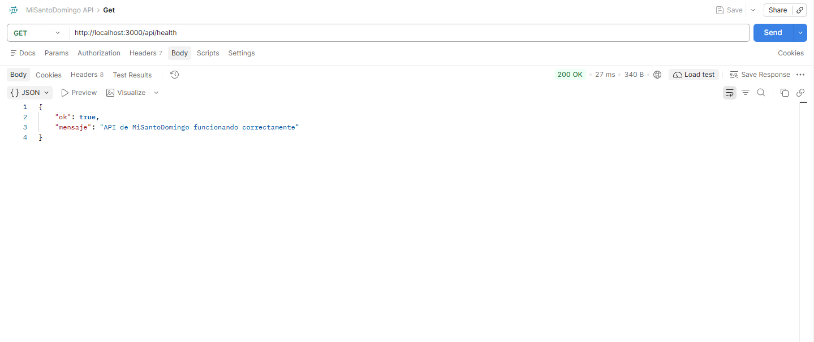

**2. Login del vecino — 200 OK**

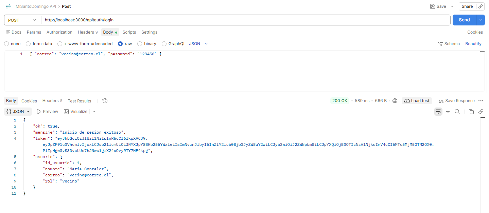

**3. Login del administrador — 200 OK**

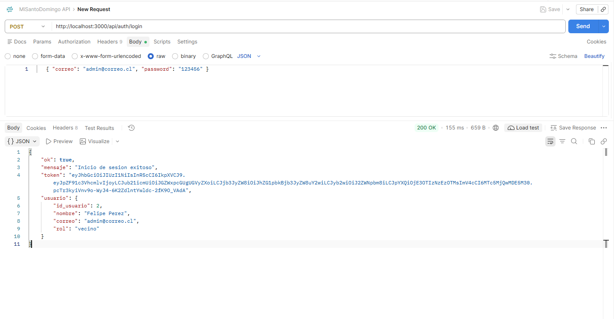

**4. Listado de categorías — 200 OK**

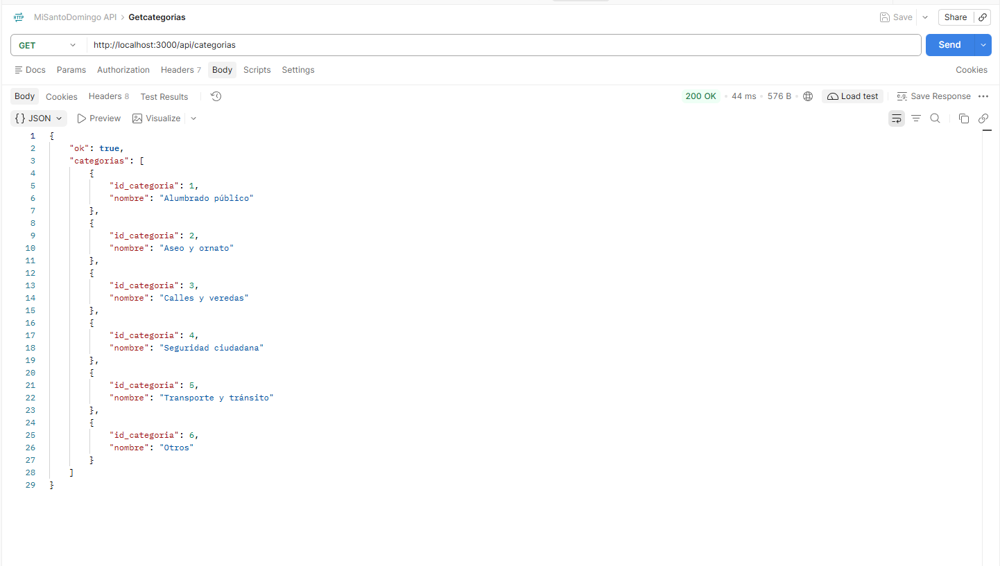

**5. Listado de reclamos con token — 200 OK**

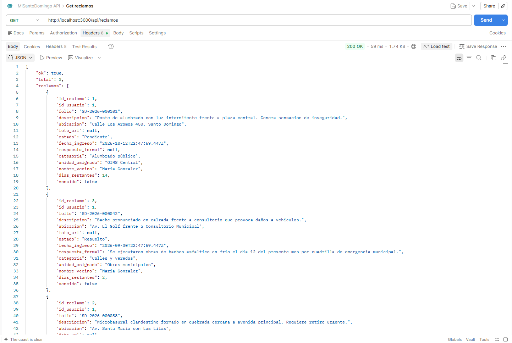

**6. Login con clave errónea — 401 Unauthorized**

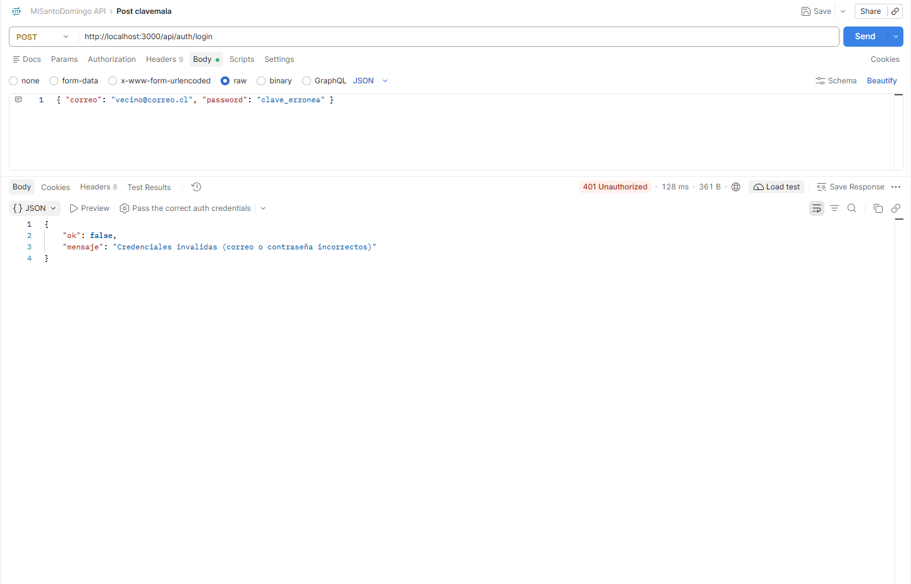

**7. Login sin contraseña — 400 Bad Request**

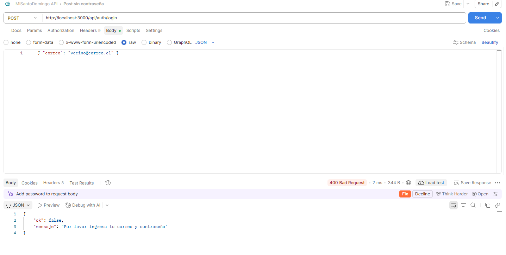

**8. Consulta de un folio inexistente — 404 Not Found**

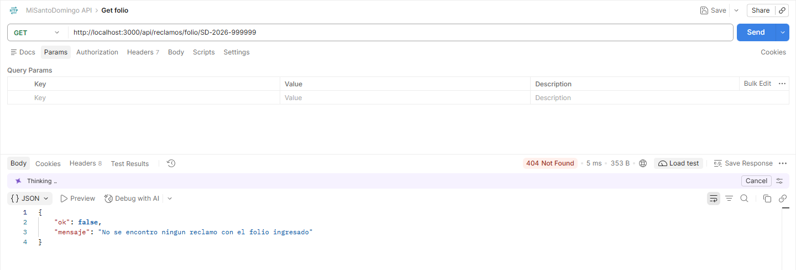

**9. Cambio de estado sin ser administrador — 403 Forbidden**

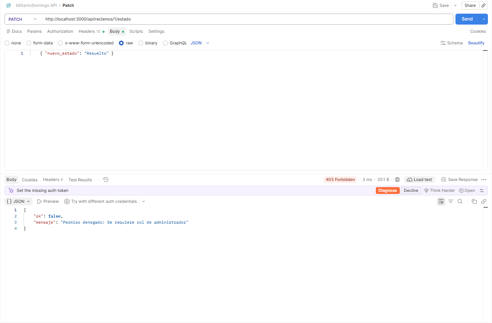

**10. Registro de un usuario nuevo — 201 Created**

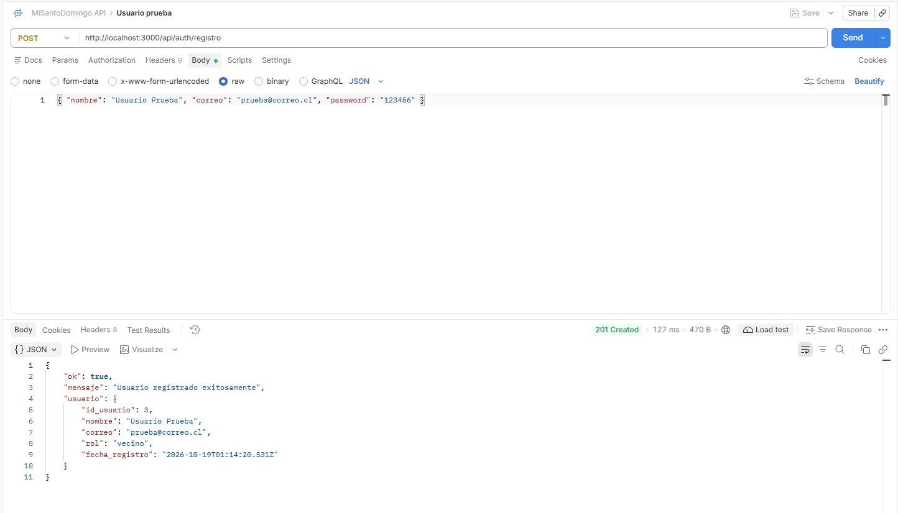

**11. Registro con un correo repetido — 409 Conflict**

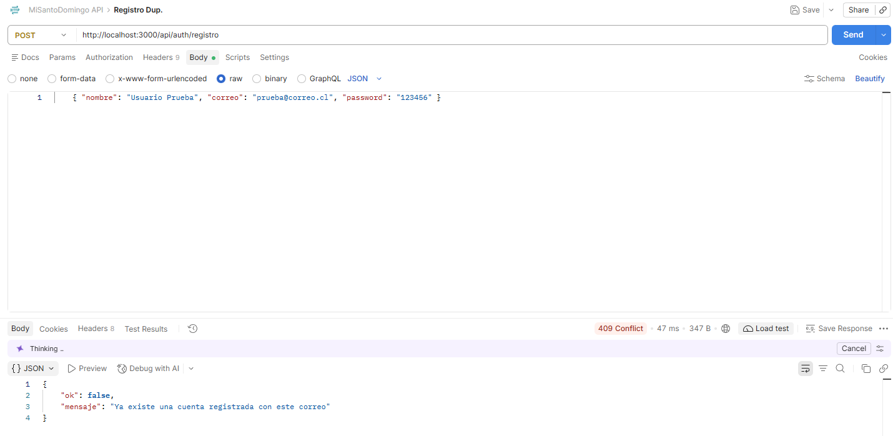

**12. Creación de un reclamo — 201 Created**

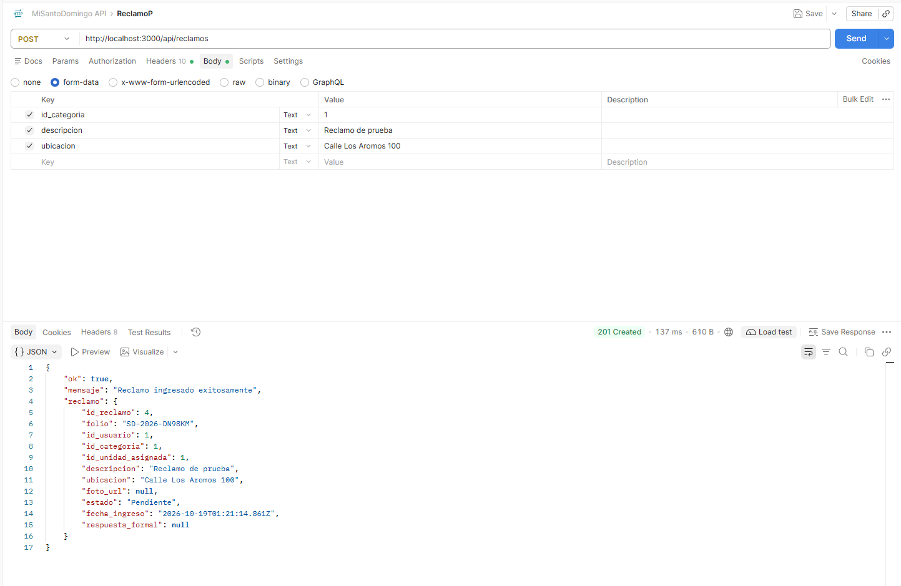

**13. Cambio de estado como administrador — 200 OK**

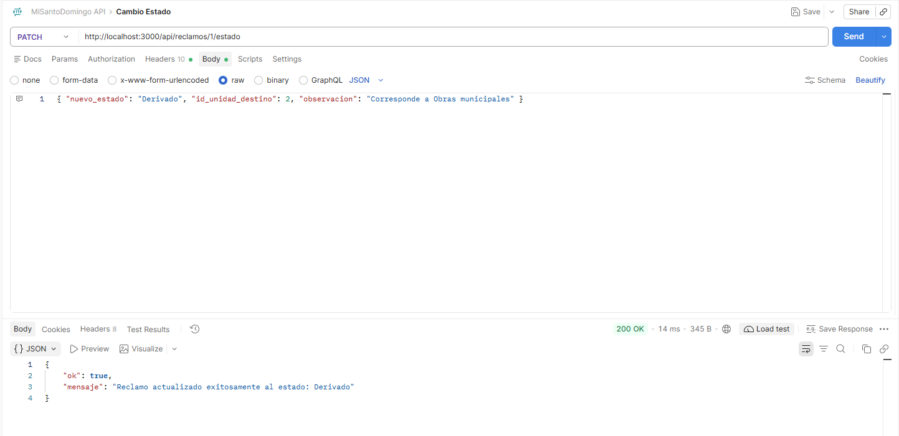

**14. Cancelación de un reclamo propio — 200 OK**

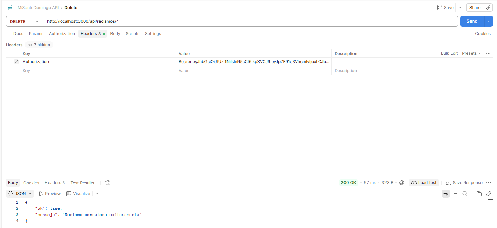

**15. Cancelación de un reclamo inexistente — 404 Not Found**

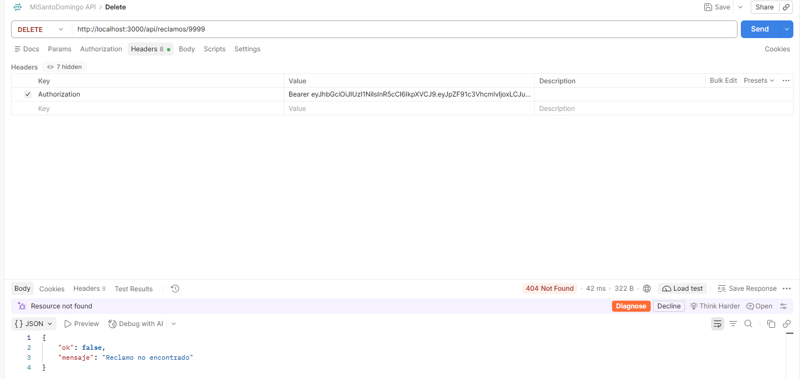

**16. Actualización de un reclamo (PUT) — 200 OK**


**17. Rate Limit — 429 Too Many Requests**


**18. Magic Bytes (archivo falso) — 400 Bad Request**


**19. Rechazo de XSS (`<script>`) — 400 Bad Request**


---

## 18. Integración frontend y backend

El frontend (rama `frontend`, Ionic + React + TypeScript) consume esta API mediante `fetch` nativo encapsulado en `src/services/api.ts` (`apiFetch`), apuntando a `VITE_API_URL` (`http://localhost:3000/api`):

- **Sesión persistente:** el JWT y el usuario se almacenan mediante **`@capacitor/preferences`** (con migración automática desde `localStorage` y sincronización en memoria antes de renderizar React). Ante una respuesta `401` (o `403` por token), `apiFetch` limpia sesión y caché local y redirige a `/login?expirada=1`.
- **Flujos reales integrados:** registro, login, carga dinámica de catálogos (`GET /api/categorias` y `GET /api/unidades`), subida `multipart/form-data` de fotografías y coordenadas, visualización de imágenes y mapas de solo lectura, consulta periódica de notificaciones (`GET /api/notificaciones`), geocodificación (`GET /api/geocodificar`), administración de catálogos, paginación y exportación de reportes CSV/PDF.

---

## 19. Trazabilidad de requerimientos y progreso entre entregas

### 19.1. Matriz de trazabilidad (Backend)

| ID                  | Requerimiento                           | Implementación en Backend                                                               | Prueba que lo verifica                                  | Responsable          |
| :------------------ | :-------------------------------------- | :-------------------------------------------------------------------------------------- | :------------------------------------------------------ | :------------------- |
| **RF-01**           | Ingreso de reclamo con foto y ubicación | `POST /api/reclamos` (`reclamos.controller.js`, `upload.middleware.js`)                 | `tests/app.test.js` (#9, #11) y Postman #12, #18        | Sebastián / Ignacio  |
| **RF-02**           | Folio único `SD-AAAA-XXXXXX`            | `generarFolioUnico()` en `reclamos.service.js`                                          | `tests/app.test.js` (#11) y Postman #12                 | Sebastián            |
| **RF-03**           | Consulta pública por folio              | `GET /api/reclamos/folio/:folio`                                                        | Postman #8 y prueba funcional en vivo                   | Sebastián            |
| **RF-04**           | Cálculo de plazo legal de 20 días       | Cálculo `dias_restantes` / `vencido` en `reclamos.service.js`                           | Consulta seed `SD-2026-000088` (26 días)                | Sebastián            |
| **RF-05**           | Historial inmutable y notificaciones    | Trigger `historial_inmutable` + `notificaciones.service.js`                             | `tests/app.test.js` (#12)                               | Benjamín / Sebastián |
| **RF-06**           | Bandeja filtrable y paginada            | `GET /api/reclamos` con validación de dominio y `LIMIT/OFFSET`                          | Postman #5 y `EXPLAIN ANALYZE`                          | Sebastián            |
| **RF-07**           | Derivación entre unidades               | `PATCH /api/reclamos/:id/estado` + constraint `derivacion_completa`                     | `tests/app.test.js` (#8, #10) y Postman #13             | Sebastián            |
| **RF-08**           | Cierre formal con respuesta             | `PATCH /api/reclamos/:id/estado` + constraint `resuelto_con_respuesta`                  | Prueba E2E en vivo                                      | Sebastián            |
| **RF-09**           | Calificación única (1–5)                | `POST /api/reclamos/:id/calificacion` (`Number.isInteger` + `UNIQUE`)                   | Verificación `409` voto duplicado                       | Sebastián            |
| **RF-10**           | Dashboard de indicadores KPI            | `GET /api/reclamos?limite=100` (estados y fechas reales)                                | Postman #5 y verificación en vivo                       | Sebastián / Benjamín |
| **RF-11**           | Exportación de métricas (CSV/PDF)       | Datos reales entregados por `GET /api/reclamos`                                         | Exportación en vivo desde Dashboard                     | Equipo               |
| **EF1 (Catálogos)** | Administración dinámica de catálogos    | `GET/POST/PUT/DELETE /api/categorias` y `/api/unidades`                                 | Verificación `soloAdmin` (`403`) y `409` en uso         | Vicente              |
| **EF5**             | Geocodificación externa                 | `GET /api/geocodificar` y `/inversa` (`geocodificacion.service.js`)                     | `tests/app.test.js` (#5) y prueba en mapa               | Ignacio              |
| **RNF-03**          | Seguridad y control de acceso por rol   | `verificarToken` (rol en BD, `401`), `soloAdmin` (`403`), `helmet`, `rateLimit` (`429`) | `tests/app.test.js` (#3, #4, #7, #8) y Postman #17, #19 | Sebastián            |
| **RNF-05**          | Trazabilidad inmutable                  | Trigger `historial_inmutable` (bloquea `UPDATE`/`DELETE`) + timestamp automático        | Verificación de rechazo SQL `23514` en historial        | Sebastián            |

### 19.2. Progreso entre entregas (EP1 $\rightarrow$ EP2 $\rightarrow$ Entrega Final)

| Área                  | EP1                         | EP2                                           | Entrega Final                                                                                                                                       |
| :-------------------- | :-------------------------- | :-------------------------------------------- | :-------------------------------------------------------------------------------------------------------------------------------------------------- |
| **Persistencia y BD** | Datos simulados en frontend | PostgreSQL con 6 tablas y seeds fijos         | Scripts 100% re-ejecutables, sin IDs fijos, `id_usuario` en calificaciones, coordenadas y tabla `notificaciones`                                    |
| **Seguridad API**     | Rutas simuladas en cliente  | JWT básico, `bcrypt`, SQL parametrizado       | `helmet` (con CORP), CORS estricto, Rate Limit (`429` solo fallos), token `401` unificado, rol vigente en BD, Magic Bytes y bloqueo XSS             |
| **Rendimiento**       | Sin paginación ni índices   | Índices básicos                               | Paginación (`LIMIT/OFFSET`), eliminación de `SELECT *`, `compression`, caché ETag (`no-cache`) e índices medidos con `EXPLAIN ANALYZE` (`3.711 ms`) |
| **Servicio Externo**  | Dirección de texto libre    | Dirección de texto libre                      | Proxy Nominatim (OpenStreetMap) con cola de 1.1s, caché en memoria, timeout 5s (`502`/`504`) y tolerancia a fallos                                  |
| **Pruebas**           | Sin pruebas automatizadas   | Postman manual (16 peticiones sin aserciones) | 12 pruebas automáticas en backend (`node --test` + `supertest`) y Postman v2.1 con 19 solicitudes, tokens dinámicos y 81 `pm.test()`                |
| **Despliegue**        | Ejecución manual local      | Ejecución manual local                        | `Dockerfile` frontend y backend + `docker-compose.yml` orquestando BD, API y Nginx                                                                  |

---

## 20. Gestión del proyecto y evidencia de contribuciones

- **Ramas utilizadas:** separación en ramas `frontend` y `backend`, etiquetadas al cierre de la entrega final.
- **Convención de commits:** commits incrementales y descriptivos siguiendo formato convencional (`feat(...)`, `fix(...)`, `test(...)`, `docs(...)`).

| Integrante           | Usuario(s) de GitHub                              | Historial directo                                                                                                                                                                                                         |
| :------------------- | :------------------------------------------------ | :------------------------------------------------------------------------------------------------------------------------------------------------------------------------------------------------------------------------ |
| **Sebastián Garay**  | `sebagarayn`                                      | [Ver commits de Sebastián](https://github.com/sebagarayn/MiSantoDomingo/commits?author=sebagarayn)                                                                                                                        |
| **Benjamín Lazcano** | `benjaminlazcanor-hub` / `lazcanobenjamin83-arch` | [Ver commits (cuenta 1)](https://github.com/sebagarayn/MiSantoDomingo/commits?author=benjaminlazcanor-hub) · [Ver commits (cuenta 2)](https://github.com/sebagarayn/MiSantoDomingo/commits?author=lazcanobenjamin83-arch) |
| **Vicente Olguín**   | `Vichonoma`                                       | [Ver commits de Vicente](https://github.com/sebagarayn/MiSantoDomingo/commits?author=Vichonoma)                                                                                                                           |
| **Ignacio Maureira** | `IgnacioMaureira`                                 | [Ver commits de Ignacio](https://github.com/sebagarayn/MiSantoDomingo/commits?author=IgnacioMaureira)                                                                                                                     |

> **Nota sobre Benjamín Lazcano:** Los alias `benjaminlazcanor-hub` y `lazcanobenjamin83-arch` corresponden al mismo estudiante, debido a configuraciones locales en diferentes computadores.

---

## 21. Enlaces

| Recurso                            | Enlace                                                                                                                           |
| ---------------------------------- | -------------------------------------------------------------------------------------------------------------------------------- |
| Repositorio GitHub                 | [Repositorio MiSantoDomingo](https://github.com/sebagarayn/MiSantoDomingo)                                                       |
| Prototipo Figma (Web / Escritorio) | [Figma Versión Escritorio](https://www.figma.com/design/g226BWBCK7VZ2fzl9aj8at/Sin-t%C3%ADtulo?node-id=0-1&t=OWk7vIgmDlFjNYgl-1) |
| Prototipo Figma (Móvil)            | [Figma Versión Móvil](https://www.figma.com/design/APracKRLzJMMzqzsLFHSXx/Sin-t%C3%ADtulo?node-id=0-1&t=x8JV6gNCCvaOFn40-1)      |
| Colección Postman                  | [Colección MiSantoDomingo](pruebas/MiSantoDomingo.postman_collection.json)                                                       |
| Capturas de las pruebas            | [Carpeta de capturas](pruebas/capturas)                                                                                          |

---

## 22. Bibliografía y uso de IA

- **Bibliografía:**
  - [Biblioteca del Congreso Nacional de Chile (BCN) — Reportes Comunales: Santo Domingo](https://www.bcn.cl/siit/reportescomunales/comunas_v.html?anno=2026&idcom=5606).
  - [Biblioteca del Congreso Nacional de Chile (BCN) — Ley N° 19.880 sobre Bases de los Procedimientos Administrativos](https://www.bcn.cl/leychile/navegar?idNorma=210676) (plazo legal de respuesta de 20 días en OIRS municipal).
  - Instituto Nacional de Estadísticas (INE). _Censo de Población y Vivienda 2017 y 2024_.
  - Contraloría General de la República de Chile (CGR). _Dictámenes e informes de fiscalización sobre plazos de respuesta ciudadana y trazabilidad en municipalidades_.
  - [OpenStreetMap — Política de uso de Nominatim](https://operations.osmfoundation.org/policies/nominatim/).

- **Uso de IA:**  
  En el desarrollo de este proyecto se utilizó inteligencia artificial como herramienta de apoyo para orientación en arquitectura modular, refactorización de consultas SQL parametrizadas, diseño de pruebas y documentación técnica. Todo el código fuente, configuración de contenedores y scripts SQL fueron revisados, probados, adaptados y validados directamente por los integrantes del equipo.
