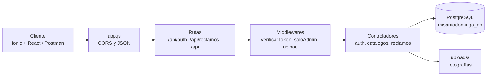
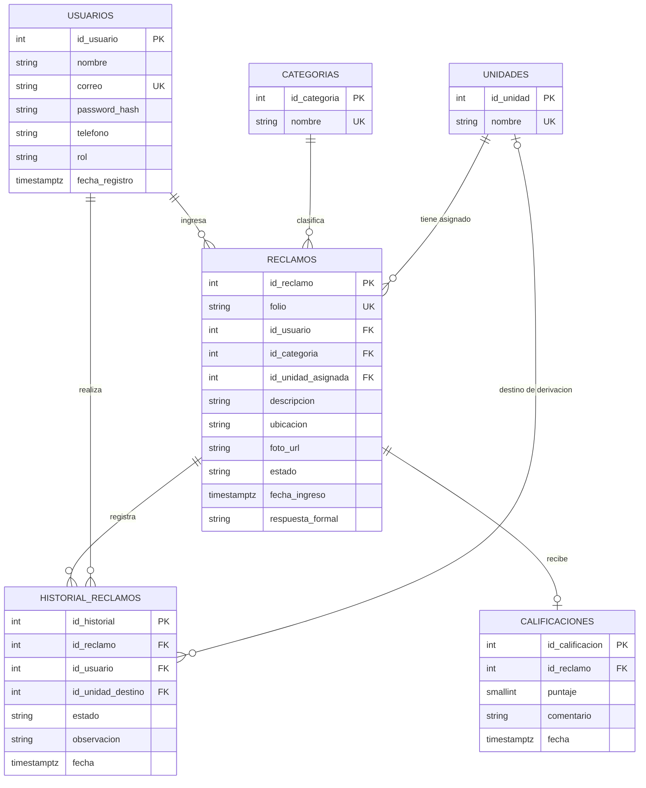

# MiSantoDomingo

<div align="center">
  
  <p><b>Plataforma Municipal de Atención y Seguimiento de Reclamos Vecinales</b></p>
</div>

---


## Índice
1. [Identificación de los integrantes del equipo y sus roles](#1-identificación-de-los-integrantes-del-equipo-y-sus-roles)
2. [Distribución de responsabilidades](#2-distribución-de-responsabilidades)
3. [Descripción general del sistema y problema que aborda](#3-descripción-general-del-sistema-y-problema-que-aborda)
4. [Principales funcionalidades](#4-principales-funcionalidades)
5. [Tecnologías y herramientas utilizadas](#5-tecnologías-y-herramientas-utilizadas)
6. [Arquitectura y estructura del backend](#6-arquitectura-y-estructura-del-backend)
7. [Base de datos](#7-base-de-datos)
8. [Instrucciones de instalación y configuración](#8-instrucciones-de-instalación-y-configuración)
9. [Variables de entorno](#9-variables-de-entorno)
10. [Instrucciones de ejecución y uso](#10-instrucciones-de-ejecución-y-uso)
11. [Documentación de la API REST](#11-documentación-de-la-api-rest)
12. [Autenticación y roles (JWT)](#12-autenticación-y-roles-jwt)
13. [Seguridad y validaciones](#13-seguridad-y-validaciones)
14. [Pruebas funcionales](#14-pruebas-funcionales)
15. [Integración frontend y backend](#15-integración-frontend-y-backend)
16. [Gestión del proyecto y evidencia de contribuciones](#16-gestión-del-proyecto-y-evidencia-de-contribuciones)
17. [Enlaces](#17-enlaces)
18. [Bibliografía y uso de IA](#18-bibliografía-y-uso-de-ia)


---


## 1. Identificación de los integrantes del equipo y sus roles

**Sebastian Garay** - Arquitectura de Software, Desarrollo Frontend y Control de Calidad

**Benjamín Lazcano** - Líder de Requerimientos, Investigación y Documentación UX

**Vicente Olguin** - Diseño UI/UX y Prototipado Manual Figma (Versión Escritorio / Web)

**Ignacio Maureira** - Diseño UI/UX y Prototipado Manual Figma (Versión Móvil)

---


## 2. Distribución de responsabilidades

### 2.1. Sebastián Garay
 
Responsabilidad: Desarrollo de la API REST y de la autenticación del backend.
 
Entregables: API REST con los métodos GET, POST, PATCH y DELETE; implementación de la autenticación con JWT y gestión de los tokens; validación de las entradas de datos; redacción de las secciones del README correspondientes al trabajo que realizó.
 
### 2.2. Benjamín Lazcano
 
Responsabilidad: Apoyo en la creación de la base del servidor, diseño y scripts de la base de datos, y pruebas funcionales de la API.
 
Entregables: Diagrama de la base de datos; scripts SQL para la creación de la base de datos, de las cuentas de usuarios de prueba y de los datos de prueba; pruebas funcionales de la API en Postman, con la colección exportada en un archivo JSON y los pantallazos de cada prueba junto a sus códigos de respuesta.
 
### 2.3. Vicente Olguin
 
Responsabilidad: Redacción y estructuración del README del backend.
 
Entregables: README.md redactado según las exigencias de la segunda entrega, que cubre todos los puntos solicitados para la rama backend.
 
### 2.4. Ignacio Maureira
 
Responsabilidad: Apoyo en la redacción del README y corrección del prototipo en Figma.
 
Entregables: Apoyo en la redacción del README del backend; corrección del prototipo en Figma (responsabilidad asignada al equipo, no exigida en esta entrega).

---


## 3. Descripción general del sistema y problema que aborda

### 3.1. Descripción general del sistema

**API REST** desarrollada con **Node.js**, **Express** y **PostgreSQL** que da soporte a la plataforma MiSantoDomingo. Este sistema reemplaza los servicios **MOCK** del frontend por datos reales y se encarga de:  

- **Registro e inicio de sesión**: Permite a los vecinos crear una cuenta e ingresar a la plataforma mediante un token **JWT**, que identifica el rol como vecino o admin.

- **Gestión de reclamos**: Permite ingresar reclamos con una fotografía opcional, generar un folio único para cada reclamo, actualizar el estado del reclamo, derivar el reclamo entre unidades municipales, registrar una respuesta formal al cerrar los reclamos y gestionar la cancelación de los reclamos.

- **Control de plazos**: Calcula el tiempo restante del plazo legal de 20 días para responder los reclamos e identifica los reclamos que ya se encuentran vencidos.

- **Historial de cambios**: Registra las modificaciones de estado de cada reclamo manteniendo la trazabilidad de la gestión.

- **Calificación ciudadana**: Permite que los usuarios califiquen la atención que recibieron en una escala de puntuación de 1 a 5 estrellas, evitando que un mismo usuario vote más de una vez.


### 3.2. Problema o necesidad que aborda


Tiempos de respuesta prolongados o falta de soluciones efectivas a los reclamos y
solicitudes que los ciudadanos ingresan al municipio, generando frustración.

> La justificación completa del problema y la caracterización de usuarios se encuentra en el README de la rama `frontend`.

### 3.3. Objetivos del proyecto


- Disponer de un canal ciudadano digital accesible para ingresar reclamos en menos de 3 minutos con obtención inmediata de comprobante único de folio.
  
- Garantizar la trazabilidad completa del ciclo de vida del reclamo tanto para el vecino como para los funcionarios municipales.
  
- Proporcionar al municipio una herramienta administrativa para medir tiempos de respuesta frente al plazo legal de 20 días y priorizar la gestión mediante indicadores **KPI**.


### 3.4. Objetivos específicos del backend


- Exponer la **API REST** con operaciones **GET**, **POST**, **PATCH** y **DELETE** sobre una base de datos relacional **PostgreSQL**, con respuestas **JSON** consistentes y códigos **HTTP** adecuados.

- Autenticar y autorizar a vecinos y funcionarios mediante **JWT**, restringiendo las acciones de gestión al rol administrador.

- Garantizar la integridad y trazabilidad de los datos mediante restricciones en la base datos, transacciones y un historial inmutable.


## 4. Principales funcionalidades

<!-- -->

### 4.1. Rol Vecino/Vecina

Los vecinos y vecinas pueden utilizar la plataforma para ingresar reclamos, consultar su estado y hacer seguimiento de su resolución. Las funcionalidades disponibles para este rol son las siguientes:
 
-  **Registro e inicio de sesión**: Permite crear una cuenta e ingresar a la plataforma. Al crearse una cuenta, el sistema automáticamente le asignara el rol de vecino.

-  **RF-01. Ingreso de reclamos**: Permite ingresar un reclamo indicando la categoría, descripción y ubicación, además de poder adjuntar una fotografía de forma opcional. Se aceptan imágenes en formato **JPEG**, **PNG** o **WebP**, con un tamaño máximo de 5 MB.

-  **RF-02. Generación de Folio**: Al ingresar un reclamo, el sistema genera un folio único con el formato SD-AAAA-XXXXXX, que permite identificarlo y consultarlo posteriormente.

- **RF-04. Seguimiento de plazos**: Permite conocer los días restantes del plazo legal de 20 días para la resolución del reclamo y verificar si este se encuentra vencido.

- **RF-05. Consulta de reclamos**: Permite revisar el listado de reclamos ingresados por el propio usuario, acceder al detalle de cada uno y consultar el historial de cambios del reclamo.

- **RF-09. Calificación del servicio**: Permite calificar con una puntuación de 1 a 5 estrellas a un reclamo que haya sido resuelto. **SOLO** la persona que ingresó el reclamo puede calificar y se admite solamente un voto.

- **Cancelación de reclamos**: Permite al vecino/vecina cancelar un reclamo propio mientras este reclamo se encuentre en el estado **"Pendiente"** cambiando el estado a **"Rechazado"**.

### 4.2. Rol Funcionario municipal (OIRS)

El funcionario municipal encargado de la OIRS puede acceder a los reclamos ingresados por los vecinos y gestionar su seguimiento hasta su resolución. Para ello, cuenta con las siguientes funcionalidades:
 
- **Inicio de sesión**: Permite ingresar a la plataforma con una cuenta que tenga asignado el rol admin.

- **RF-05. Consulta del historial**: Permite revisar el historial completo de cada reclamo, incluyendo los cambios realizados y el responsable de cada acción, lo que le facilita al administrador el seguimiento de su gestión.

- **RF-06. Consulta y filtrado de reclamos**: Permite visualizar todos los reclamos registrados en el sistema y filtrarlos por estado, categoría o unidad municipal. También permite buscar casos específicos mediante su folio o descripción.

- **RF-07. Derivación de reclamos**: Permite derivar un reclamo a otra unidad municipal para que sea gestionado por el área correspondiente. Para realizar la derivación es obligatorio indicar la unidad de destino y un motivo de la derivación.

- **RF-08. Gestión y cierre de reclamos**: Permite actualizar el estado de un reclamo durante su gestión y marcarlo como **"Resuelto"**, siempre que se ingrese una respuesta formal.

### 4.3. Acceso público (sin sesión)
 
- **RF-03. Consulta pública de reclamos**: Permite consultar un reclamo ingresando su número de folio. La información disponible incluye el estado actual del reclamo, la unidad municipal asignada, el plazo de respuesta, el historial de cambios y la calificación registrada.

- **Consulta de catálogos**: Permite acceder a los listados de categorías de reclamos y las unidades municipales que se encuentran disponibles actualmente en la plataforma.

- **Verificación del servidor**: Permite comprobar si el **backend** se encuentra operativo mediante el endpoint (`/api/health`).

---

## 5. Tecnologías y herramientas utilizadas

 
| Categoría | Tecnología | Versión |
|---|---|---|
| Lenguaje / Runtime | Node.js (módulos ES) | 18.11 o superior |
| Framework backend | Express | 4.19.2 |
| Base de datos relacional | PostgreSQL (administrada con pgAdmin) | |
| Acceso a datos | `pg` (consultas SQL parametrizadas, sin ORM) | 8.12.0 |
| Autenticación | JSON Web Token (`jsonwebtoken`) | 9.0.2 |
| Hash de contraseñas | `bcryptjs` | 2.4.3 |
| Carga de archivos | `multer` | 1.4.5-lts.1 |
| CORS | `cors` | 2.8.5 |
| Variables de entorno | `dotenv` | 16.4.5 |
| Validación de datos | Validaciones manuales en los controladores y restricciones `CHECK` en la base de datos | |
| Pruebas de API | Postman (escritorio) | |
| Control de versiones | Git y GitHub | |
 
---


## 6. Arquitectura y estructura del backend


El backend sigue una arquitectura en capas. Cada petición pasa por `app.js` (CORS y lectura de JSON), las **rutas** (`routes/`) que definen los endpoints, los **middlewares** (`middlewares/`) que verifican el JWT, el rol y la carga de archivos, y los **controladores** (`controllers/`), que contienen la lógica de negocio y ejecutan las consultas SQL sobre PostgreSQL a través de un pool de conexiones (`config/db.js`). Las operaciones que modifican varias tablas se ejecutan dentro de transacciones.


### 6.1. Estructura del proyecto


```
MiSantoDomingo/                 # rama backend
├── database/
│   ├── 00_crear_base.sql       # Crea la base de datos misantodomingo_db
│   ├── schema.sql              # Tablas, restricciones, índices, trigger y catálogos
│   ├── 01_usuarios_prueba.sql  # Cuentas de demostración
│   └── 02_datos_prueba.sql     # Reclamos de prueba con historial
├── pruebas/
│   ├── MiSantoDomingo.postman_collection.json
│   └── capturas/               # Evidencia de las pruebas en Postman 
├── src/
│   ├── config/
│   │   └── db.js               # Pool de conexiones a PostgreSQL
│   ├── controllers/
│   │   ├── auth.controller.js      # Registro, login y perfil
│   │   ├── catalogos.controller.js # Categorías y unidades
│   │   └── reclamos.controller.js  # Ciclo de vida de los reclamos
│   ├── middlewares/
│   │   ├── auth.middleware.js      # verificarToken y soloAdmin
│   │   └── upload.middleware.js    # Carga de fotografías (Multer)
│   ├── routes/
│   │   ├── auth.routes.js
│   │   ├── catalogos.routes.js
│   │   └── reclamos.routes.js
│   └── app.js                  # Configuración de Express y montaje de rutas
├── uploads/                    # Fotografías subidas (se crea sola; ignorada por Git)
├── .env.example                # Plantilla de variables de entorno
├── .gitignore
├── package.json
├── package-lock.json
├── README.md
└── server.js                   # Punto de entrada: levanta el servidor y verifica la BD
```


### 6.2. Diagrama de arquitectura




---

## 7. Base de Datos

### 7.1. Creación de la base

La base de datos se llama `misantodomingo_db`. Se crea ejecutando el script `database/00_crear_base.sql` conectado a la base `postgres` (Query Tool sobre `postgres`, abrir el archivo y presionar F5). También se puede crear a mano en pgAdmin: clic derecho sobre **Databases** → **Create** → **Database...** y escribir `misantodomingo_db`.

### 7.2. Scripts SQL y orden de ejecución

Los scripts están en la carpeta `database/` y **deben ejecutarse en este orden**. El primero se ejecuta sobre la base `postgres`; los otros tres, sobre `misantodomingo_db` (Query Tool, abrir el archivo y presionar F5):

| Orden | Archivo | Qué hace |
| :---- | :------ | :------- |
| 1 | `00_crear_base.sql` | Crea la base de datos `misantodomingo_db`. |
| 2 | `schema.sql` | Crea las tablas, restricciones y los catálogos (6 categorías y 5 unidades). No incluye usuarios. |
| 3 | `01_usuarios_prueba.sql` | Crea las cuentas de demostración (vecino y funcionario OIRS). |
| 4 | `02_datos_prueba.sql` | Carga 3 reclamos de prueba con su historial. |
 
**Justificación de `01_usuarios_prueba.sql`:** el `schema.sql` solo crea la estructura
y los catálogos, pero ningún usuario. Sin usuarios no se puede iniciar sesión ni probar
las rutas protegidas, y `02_datos_prueba.sql` falla porque sus reclamos referencian a los
usuarios con id 1 y 2 (llaves foráneas). Este script deja la base lista solo con scripts
SQL, sin registrar usuarios a mano por la API. Las contraseñas se almacenan hasheadas con
bcrypt.

### 7.3. Datos de prueba (`02_datos_prueba.sql`)

Permite validar en vivo los casos borde del sistema:
 
| Folio | Estado | Antigüedad | Caso que valida |
| :---- | :----- | :--------- | :-------------- |
| `SD-2026-000101` | Pendiente | 3 días | Reclamo reciente dentro de plazo |
| `SD-2026-000088` | Derivado | 26 días | Plazo legal de 20 días vencido y derivación a unidad |
| `SD-2026-000042` | Resuelto | 15 días | Reclamo con respuesta formal, listo para probar la calificación de 1 a 5 estrellas |
 
Cada reclamo incluye su registro en `historial_reclamos`.

### 7.4. Verificación

Ejecutar en el Query Tool:
 
```sql
SELECT folio, estado,
       CURRENT_DATE - fecha_ingreso::date AS dias_transcurridos
FROM reclamos
ORDER BY fecha_ingreso;
```
Deben aparecer 3 reclamos (26, 15 y 3 días).

### 7.5. Modelo relacional



### 7.6. Descripción de tablas

| Tabla | Descripción | Clave primaria | Claves foráneas |
|---|---|---|---|
| `usuarios` | Cuentas de vecinos y funcionarios OIRS | `id_usuario` | — |
| `categorias` | Catálogo de categorías de reclamo | `id_categoria` | — |
| `unidades` | Catálogo de unidades municipales | `id_unidad` | — |
| `reclamos` | Reclamos ingresados por los vecinos | `id_reclamo` | `id_usuario` → `usuarios`; `id_categoria` → `categorias`; `id_unidad_asignada` → `unidades` |
| `historial_reclamos` | Trazabilidad de cada cambio de estado y derivación (inmutable) | `id_historial` | `id_reclamo` → `reclamos`; `id_usuario` → `usuarios`; `id_unidad_destino` → `unidades` (opcional) |
| `calificaciones` | Calificación de 1 a 5 de un reclamo resuelto (voto único) | `id_calificacion` | `id_reclamo` → `reclamos` (único) |

### 7.7. Restricciones e integridad

| Tipo | Detalle |
|---|---|
| Claves primarias | Identificadores autogenerados (`GENERATED ALWAYS AS IDENTITY`) en todas las tablas |
| `NOT NULL` | Campos esenciales de cada tabla (nombre, correo, hash, folio, descripción, ubicación, estado, etc.) |
| `UNIQUE` | `usuarios.correo`, `reclamos.folio`, nombres de `categorias` y `unidades`, y `calificaciones.id_reclamo` (garantiza el voto único) |
| `CHECK` de dominio | `rol` solo `vecino` o `admin`; `estado` solo `Pendiente`, `En Revisión`, `Derivado`, `Resuelto` o `Rechazado`; `puntaje` entre 1 y 5; textos obligatorios sin espacios vacíos |
| `CHECK` de negocio | `resuelto_con_respuesta` (un reclamo resuelto exige respuesta formal); `derivacion_completa` (una derivación exige unidad de destino y observación); `destino_solo_derivacion` (solo las derivaciones llevan unidad de destino); `correo_normalizado` (correo en minúsculas y con formato válido) |
| Claves foráneas | Todas con `ON DELETE RESTRICT`: no se puede borrar un registro referenciado. No se define `ON UPDATE` (se usa el comportamiento por defecto, `NO ACTION`) |
| Trigger | `historial_inmutable` impide modificar o eliminar filas de `historial_reclamos` |
| Índices | Por usuario, categoría y unidad en `reclamos`, y por reclamo y fecha en `historial_reclamos` |
 
> **Aviso:** si las cuentas de demostración ya se crearon registrándolas por la API
> (`POST /api/auth/registro`), no ejecutar `01_usuarios_prueba.sql`, porque los
> correos ya existen y daría error de duplicado. Ese script es para bases nuevas.
 
---


## 8. Instrucciones de instalación y configuración

### 8.1. Requisitos previos

- **Node.js:** versión 18.11 o superior.
- **npm:** versión 9.x o superior.
- **PostgreSQL y pgAdmin:** instalados y con el servicio de PostgreSQL en ejecución.
- **Git:** instalado en el sistema operativo.
- **Postman** (opcional): para probar los endpoints.


### 8.2. Pasos de instalación

**En Visual studio**:

**Paso 1. Clonar el repositorio**

```bash
   git clone https://github.com/sebagarayn/MiSantoDomingo.git
```
 
**Paso 2. Entrar al directorio del proyecto**

```bash
   cd MiSantoDomingo
```
 
**Paso 3. Cambiar a la rama backend**

```bash
   git checkout backend
```
 
**Paso 4. Instalar las dependencias**

```bash
   npm install
```

**Paso 5. Crear la base de datos** *(pgAdmin 4)*
 
1. Conectarse al servidor de PostgreSQL (ícono del elefante).
2. Clic derecho sobre la base **postgres** → **Query Tool**.
3. Abrir el archivo `database/00_crear_base.sql` (ícono de carpeta, **Open File**) y presionar **F5**. Crea la base `misantodomingo_db`.
4. Actualizar el árbol (clic derecho sobre **Databases** → **Refresh**) y comprobar que aparece `misantodomingo_db`.
Si no encuentras el archivo, se puede crear la base a mano: clic derecho sobre **Databases** → **Create** → **Database...**, escribir exactamente `misantodomingo_db` y presionar **Save**.
 
**Paso 6. Crear las tablas y cargar los datos** *(pgAdmin 4)*
 
Este paso se hace dentro de la base recién creada. Se abren y ejecutan **uno por uno** los tres archivos de la carpeta `database/`, en este orden:
 
| Orden | Archivo | Qué hace |
| :---- | :------ | :------- |
| 1 | `schema.sql` | Crea las tablas, restricciones y los catálogos (6 categorías y 5 unidades). No incluye usuarios. |
| 2 | `01_usuarios_prueba.sql` | Crea las cuentas de demostración (vecino y funcionario OIRS). |
| 3 | `02_datos_prueba.sql` | Carga 3 reclamos de prueba con su historial. |
 
1. En el árbol de pgAdmin, abrir **Databases** y hacer clic derecho sobre **`misantodomingo_db`** (la que acabas de crear, no `postgres`) → **Query Tool**.
2. En la barra de la ventana del Query Tool, presionar el ícono de carpeta (**Open File**).
3. Buscar la carpeta `MiSantoDomingo/database/`, abrir `schema.sql` y presionar **F5**. Debe aparecer el mensaje *Query returned successfully*.
4. Repetir los pasos 2 y 3 con `01_usuarios_prueba.sql` y después con `02_datos_prueba.sql`.
Si no sabes dónde quedó la carpeta del proyecto: en Visual Studio Code, clic derecho sobre la carpeta `database` → **Reveal in File Explorer**; o en la terminal, dentro de `MiSantoDomingo`, ejecutar `pwd` para ver la ruta.
 
> **Importante:** el orden no se puede alterar, porque `02_datos_prueba.sql` necesita las cuentas creadas por `01_usuarios_prueba.sql`. Si las cuentas de demostración ya se crearon registrándolas por la API (`POST /api/auth/registro`), no ejecutar `01_usuarios_prueba.sql`, porque los correos ya existen y daría error de duplicado.
 
Para comprobar que todo se cargó bien, en el mismo Query Tool abrir una pestaña nueva y ejecutar con **F5**:
 
```sql
SELECT folio, estado,
       CURRENT_DATE - fecha_ingreso::date AS dias_transcurridos
FROM reclamos
ORDER BY fecha_ingreso;
```
 
Deben aparecer 3 reclamos (26, 15 y 3 días).
 
**Paso 7. Crear el archivo de variables de entorno** *(Terminal, dentro de la carpeta `MiSantoDomingo`)*
 
Hay que crear una copia del archivo `.env.example` con el nombre `.env`. En la terminal, estando dentro de `MiSantoDomingo`:
 
- En Windows (PowerShell o terminal de Visual Studio Code):
```powershell
  Copy-Item .env.example .env
```
 
- En Linux / macOS:
```bash
  cp .env.example .env
```
 
También se puede hacer a mano en Visual Studio Code: clic derecho sobre `.env.example` → **Copy**, clic derecho en un espacio vacío del panel → **Paste**, y renombrar la copia a `.env`.
 
**Paso 8. Completar el archivo `.env`** *(Visual Studio Code o editor de texto)*
 
Abrir la carpeta `MiSantoDomingo` en Visual Studio Code (**File → Open Folder...**), abrir el archivo `.env` y dejarlo así, cambiando solo `PGPASSWORD`
 
```env
PORT=3000
PGHOST=localhost
PGPORT=5432
PGDATABASE=misantodomingo_db
PGUSER=postgres
PGPASSWORD=tu_contraseña_de_postgres
JWT_SECRET=una_cadena_larga_y_aleatoria
```
 
- `PGPASSWORD`: la contraseña que configuraste al instalar PostgreSQL.
- `JWT_SECRET`: obligatoria. Si falta, el servidor no inicia y muestra un mensaje en la terminal.
- El archivo `.env` está en `.gitignore`: no se sube al repositorio.

Guardar el archivo (Ctrl + S).
 
**Paso 9. Comprobar la instalación** *(Terminal y navegador)*
 
En la terminal, dentro de `MiSantoDomingo`:
 
```bash
npm run dev
```
 
En la terminal debe aparecer la confirmación de la conexión con PostgreSQL, y el servidor queda disponible en `http://localhost:3000`. En el navegador, abrir `http://localhost:3000/api/health`: debe responder con un JSON de estado correcto.
 
---

## 9. Variables de entorno

El archivo `.env` se encuentra protegido y excluido del repositorio mediante `.gitignore` para cumplir con la rúbrica de no exponer credenciales ni secretos en GitHub.

Para configurar el entorno local, se debe copiar la plantilla de ejemplo:
  
- **En Windows PowerShell:**
  ```powershell
  Copy-Item .env.example .env
  ```
  
- **En Linux / macOS:**
  ```bash
  cp .env.example .env
  ```

| Variable     | Descripción                                              | Valor recomendado / Ejemplo                     |
| :----------- | :------------------------------------------------------- | :---------------------------------------------- |
| `PORT`       | Puerto local en el que escucha el servidor Express       | `3000`                                          |
| `PGHOST`     | Servidor o host de la base de datos PostgreSQL           | `localhost`                                     |
| `PGPORT`     | Puerto de conexión a PostgreSQL                          | `5432`                                          |
| `PGDATABASE` | Nombre de la base de datos relacional creada en pgAdmin  | `misantodomingo_db`                             |
| `PGUSER`     | Usuario administrador de PostgreSQL                      | `postgres`                                      |
| `PGPASSWORD` | Contraseña local configurada en pgAdmin / PostgreSQL     | _Tu contraseña local_                           |
| `JWT_SECRET` | Clave secreta para la firma y verificación de tokens JWT | `secreto_jwt_super_seguro_para_evaluacion_2026` |

> **Nota de Seguridad (Criterio 2.5):** La variable `JWT_SECRET` es estrictamente obligatoria. El servidor implementa validación al inicio (`Fail-Fast`); si la variable no existe en el archivo `.env`, el servidor aborta el arranque con un mensaje claro en la terminal para impedir la ejecución con secretos por defecto vulnerables.

---

## 10. Instrucciones de ejecución y uso
 
### 10.1. Levantar el servidor
 
En la terminal de Visual Studio Code, dentro de la carpeta `MiSantoDomingo`:
 
```bash
npm run dev     # desarrollo, con reinicio automático
npm start       # producción
```
 
El servidor queda en `http://localhost:3000` y, al iniciar, confirma la conexión con
PostgreSQL en la consola. En modo `dev` el servidor se reinicia solo al detectar
cambios en archivos; si una petición falla con `ECONNRESET` justo en ese momento, basta
reenviarla.
 
### 10.2. Cuentas de demostración
 
Cuentas creadas con `database/01_usuarios_prueba.sql` y alineadas con las proto-personas definidas para el proyecto:
 
| Rol | Nombre | Correo electrónico | Contraseña | Permisos y capacidades |
| :-- | :----- | :----------------- | :--------- | :--------------------- |
| **Vecina (ciudadana)** | Maria Gonzalez | `vecino@correo.cl` | `123456` | Ingresar reclamos, consultar "Mis Reclamos", calificar con estrellas casos resueltos y cancelar reclamos propios en estado Pendiente. |
| **Funcionario OIRS (admin)** | Felipe Perez | `admin@correo.cl` | `123456` | Bandeja general con filtros combinados, derivación a unidades técnicas y cierre formal con respuesta oficial. |
 
### 10.3. Uso de la API
 
1. Iniciar sesión: `POST /api/auth/login` con body JSON `{ "correo": "vecino@correo.cl", "password": "123456" }`. Devuelve un token JWT.
2. Para rutas protegidas, enviar el header `Authorization: Bearer <token>` (el token expira a las 8 horas).
3. Ejemplos rápidos:
   - Público (sin token): `GET /api/reclamos/folio/SD-2026-000101`
   - Con token: `GET /api/reclamos`
   - Calificar un reclamo resuelto (solo su dueño): `POST /api/reclamos/:id/calificacion`
     con body `{ "puntaje": 5 }`. La calificación es de voto único.
---

## 11. Documentación de la API REST

URL base: `http://localhost:3000`. Todas las respuestas son JSON con el campo `ok` (`true` o `false`) y, en los errores, un `mensaje`. Las rutas protegidas requieren el header `Authorization: Bearer <token>`.

### 11.1. Resumen de endpoints
  
| Método | Ruta | Descripción | Autenticación | Rol requerido |
|---|---|---|---|---|
| GET | `/api/health` | Verifica que la API esté funcionando | No | Público |
| POST | `/api/auth/registro` | Registra un nuevo vecino | No | Público |
| POST | `/api/auth/login` | Inicia sesión y entrega el token JWT | No | Público |
| GET | `/api/auth/perfil` | Devuelve los datos del usuario del token | Sí | Cualquiera |
| GET | `/api/categorias` | Lista las categorías de reclamo | No | Público |
| GET | `/api/unidades` | Lista las unidades municipales | No | Público |
| GET | `/api/reclamos/folio/:folio` | Consulta pública de un reclamo por folio | No | Público |
| GET | `/api/reclamos` | Lista reclamos (vecino: los suyos; admin: todos, con filtros) | Sí | Vecino / Admin |
| POST | `/api/reclamos` | Ingresa un nuevo reclamo (foto opcional) | Sí | Usuario autenticado |
| GET | `/api/reclamos/:id` | Detalle de un reclamo con historial y calificación | Sí | Dueño del reclamo / Admin |
| PATCH | `/api/reclamos/:id/estado` | Actualiza estado, deriva o cierra un reclamo | Sí | Admin |
| DELETE | `/api/reclamos/:id` | Cancela un reclamo en estado `Pendiente` | Sí | Dueño del reclamo / Admin |
| POST | `/api/reclamos/:id/calificacion` | Califica de 1 a 5 un reclamo resuelto | Sí | Dueño del reclamo |

### 11.2. Detalle de endpoints
 
#### `POST /api/auth/registro`
 
- **Descripción:** crea una cuenta de vecino. El rol se asigna siempre como `vecino`.
- **Autenticación:** no requiere.
- **Body (JSON):** `nombre`, `correo` y `password` son obligatorios (mínimo 6 caracteres); `telefono` es opcional.
```json
{ "nombre": "Usuario Prueba", "correo": "prueba@correo.cl", "password": "123456" }
```
 
- **Respuesta exitosa (201):**
```json
{
  "ok": true,
  "mensaje": "Usuario registrado exitosamente",
  "usuario": { "id_usuario": 3, "nombre": "Usuario Prueba", "correo": "prueba@correo.cl", "rol": "vecino", "fecha_registro": "2026-10-19T01:14:20.531Z" }
}
```
 
- **Casos de error:**
| Código | Situación |
|---|---|
| 400 | Faltan campos obligatorios, o la contraseña tiene menos de 6 caracteres |
| 409 | Ya existe una cuenta con ese correo |
| 500 | Error interno del servidor |
 
#### `POST /api/auth/login`
 
- **Descripción:** valida las credenciales y entrega un token JWT con vigencia de 8 horas.
- **Autenticación:** no requiere.
- **Body (JSON):**
```json
{ "correo": "vecino@correo.cl", "password": "123456" }
```
 
- **Respuesta exitosa (200):**
```json
{
  "ok": true,
  "mensaje": "Inicio de sesion exitoso",
  "token": "<token JWT>",
  "usuario": { "id_usuario": 1, "nombre": "Maria Gonzalez", "correo": "vecino@correo.cl", "rol": "vecino" }
}
```
 
- **Casos de error:**
| Código | Situación |
|---|---|
| 400 | Falta el correo o la contraseña |
| 401 | Credenciales inválidas (el mensaje es el mismo si falla el correo o la clave) |
| 500 | Error interno del servidor |
 
#### `GET /api/reclamos/folio/:folio`
 
- **Descripción:** consulta pública de un reclamo por su folio, sin iniciar sesión (RF-03).
- **Autenticación:** no requiere.
- **Ejemplo:** `GET /api/reclamos/folio/SD-2026-000101`
- **Respuesta exitosa (200):**
```json
{
  "ok": true,
  "reclamo": {
    "id_reclamo": 1, "folio": "SD-2026-000101", "estado": "Pendiente",
    "fecha_ingreso": "2026-10-15T12:00:00.000Z", "respuesta_formal": null,
    "categoria": "Alumbrado público", "unidad_asignada": "OIRS Central",
    "dias_restantes": 17, "vencido": false
  },
  "historial": [
    { "estado": "Pendiente", "observacion": "Reclamo ingresado mediante plataforma ciudadana.", "fecha": "2026-10-15T12:00:00.000Z", "unidad_destino": null }
  ],
  "calificacion": null
}
```
 
- **Nota:** las fechas y los `dias_restantes` dependen del día en que se cargaron los datos de prueba (este reclamo se carga con 3 días de antigüedad).
- **Casos de error:**
| Código | Situación |
|---|---|
| 404 | No existe un reclamo con ese folio |
| 500 | Error interno del servidor |
 
#### `GET /api/reclamos`
 
- **Descripción:** lista reclamos. El vecino recibe solo los suyos; el administrador recibe todos y puede filtrar.
- **Autenticación:** requiere token.
- **Parámetros de consulta (opcionales):** `estado`, `id_categoria`, `id_unidad`, `busqueda` (folio o texto de la descripción).
- **Respuesta exitosa (200):** `{ "ok": true, "total": 3, "reclamos": [ ... ] }`, ordenados del más reciente al más antiguo, con `dias_restantes` y `vencido` en cada reclamo.
- **Casos de error:**
| Código | Situación |
|---|---|
| 401 | No se envió el token |
| 403 | Token inválido o expirado |
| 500 | Error interno del servidor |
 
#### `POST /api/reclamos`
 
- **Descripción:** ingresa un reclamo con estado `Pendiente`, genera su folio único (`SD-AAAA-XXXXXX`) y crea el primer registro del historial en una transacción.
- **Autenticación:** requiere token.
- **Body (`multipart/form-data`):** `id_categoria`, `descripcion` y `ubicacion` son obligatorios; `foto` es opcional (JPEG, PNG o WebP, máximo 5 MB).
- **Ejemplo de body (`form-data`):** `id_categoria` = `1`, `descripcion` = `Reclamo de prueba`, `ubicacion` = `Calle Los Aromos 100`.
- **Respuesta exitosa (201):**
```json
{
  "ok": true,
  "mensaje": "Reclamo ingresado exitosamente",
  "reclamo": {
    "id_reclamo": 4,
    "folio": "SD-2026-DN98KM",
    "id_usuario": 1,
    "id_categoria": 1,
    "id_unidad_asignada": 1,
    "descripcion": "Reclamo de prueba",
    "ubicacion": "Calle Los Aromos 100",
    "foto_url": null,
    "estado": "Pendiente",
    "fecha_ingreso": "2026-10-19T01:21:14.861Z",
    "respuesta_formal": null
  }
}
```
 
- **Casos de error:**
| Código | Situación |
|---|---|
| 400 | Faltan categoría, descripción o ubicación |
| 401 / 403 | Token ausente, o inválido o expirado |
| 500 | Error interno del servidor |
 
#### `GET /api/reclamos/:id`
 
- **Descripción:** detalle completo de un reclamo, con historial (incluye el responsable de cada acción) y calificación.
- **Autenticación:** requiere token. El vecino solo puede ver sus propios reclamos.
- **Casos de error:**
| Código | Situación |
|---|---|
| 401 / 403 | Token ausente, o inválido o expirado |
| 403 | Un vecino intenta ver un reclamo ajeno |
| 404 | Reclamo no encontrado |
| 500 | Error interno del servidor |
 
#### `PATCH /api/reclamos/:id/estado`
 
- **Descripción:** el funcionario actualiza el estado, deriva o cierra un reclamo y deja constancia en el historial.
- **Autenticación:** requiere token con rol `admin`.
- **Body (JSON):** `nuevo_estado` es obligatorio. Si es `Derivado`, se exigen `id_unidad_destino` y `observacion`. Si es `Resuelto`, se exige `respuesta_formal`.
```json
{ "nuevo_estado": "Derivado", "id_unidad_destino": 2, "observacion": "Corresponde a Obras municipales" }
```
 
- **Respuesta exitosa (200):** `{ "ok": true, "mensaje": "Reclamo actualizado exitosamente al estado: Derivado" }`
- **Casos de error:**
| Código | Situación |
|---|---|
| 400 | Falta el nuevo estado, la unidad de destino y el motivo (derivación) o la respuesta formal (cierre) |
| 401 / 403 | Token ausente, inválido o expirado, o el usuario no es administrador |
| 404 | Reclamo no encontrado |
| 409 | El reclamo ya está cerrado (`Resuelto` o `Rechazado`) |
| 500 | Error interno del servidor |
 
#### `DELETE /api/reclamos/:id`
 
- **Descripción:** cancela un reclamo en estado `Pendiente`. Es una baja lógica: el estado pasa a `Rechazado` y se registra en el historial.
- **Autenticación:** requiere token. Un vecino solo puede cancelar sus propios reclamos.
- **Respuesta exitosa (200):** `{ "ok": true, "mensaje": "Reclamo cancelado exitosamente" }`
- **Casos de error:**
| Código | Situación |
|---|---|
| 401 / 403 | Token ausente, o inválido o expirado |
| 403 | Un vecino intenta cancelar un reclamo ajeno |
| 404 | Reclamo no encontrado |
| 409 | El reclamo no está en estado `Pendiente` |
| 500 | Error interno del servidor |
 
#### `POST /api/reclamos/:id/calificacion`
 
- **Descripción:** registra la calificación ciudadana de un reclamo resuelto (RF-09). Es de voto único.
- **Autenticación:** requiere token. Solo puede calificar quien ingresó el reclamo.
- **Body (JSON):** `puntaje` entero entre 1 y 5; `comentario` es opcional.
```json
{ "puntaje": 5 }
```
 
- **Respuesta exitosa (201):** `{ "ok": true, "mensaje": "Gracias por calificar la respuesta municipal" }`
- **Casos de error:**
| Código | Situación |
|---|---|
| 400 | El puntaje no es un entero entre 1 y 5 |
| 401 / 403 | Token ausente, o inválido o expirado |
| 403 | El usuario no es quien ingresó el reclamo |
| 404 | Reclamo no encontrado |
| 409 | El reclamo no está `Resuelto`, o ya tiene una calificación (voto único) |
| 500 | Error interno del servidor |
 
### 11.3. Códigos HTTP utilizados
 
| Código | Uso |
|---|---|
| 200 | Consultas y actualizaciones exitosas |
| 201 | Recurso creado: registro de usuario, reclamo y calificación |
| 400 | Datos faltantes o inválidos |
| 401 | Falta el token o las credenciales son inválidas |
| 403 | Token inválido o expirado, o sin permisos para la acción |
| 404 | Recurso no encontrado |
| 409 | Conflicto: correo repetido, estado que no permite la acción o voto duplicado |
| 500 | Error interno del servidor |
 
---
## 12. Autenticación y roles (JWT)

### 12.1. Flujo de autenticación

1. **Credenciales:** El cliente envía `correo` y `password` al endpoint `POST /api/auth/login`.
2. **Validación:** El servidor busca el usuario en PostgreSQL y compara la contraseña contra el hash almacenado mediante `bcrypt.compare()`.
3. **Generación de Token:** Si las credenciales coinciden, se firma un token JWT con algoritmo HS256 utilizando la clave obligatoria `process.env.JWT_SECRET`.
4. **Almacenamiento y Envío:** El cliente almacena el token en `localStorage["msd_token"]` y lo adjunta en cada petición protegida mediante la cabecera `Authorization: Bearer <token>`.
5. **Middlewares de Control:**
   - `verificarToken`: Valida la firma del token y vigencia temporal.
   - `soloAdmin`: Verifica que `req.usuario.rol === 'admin'` antes de autorizar derivaciones o cierres formales.

### 12.2. Estructura del token (payload)

```json
{
  "id_usuario": 1,
  "nombre": "María González",
  "correo": "vecino@correo.cl",
  "rol": "vecino",
  "iat": 1792080000,
  "exp": 1792108800
}
```

### 12.3. Tiempo de expiración

Los tokens emitidos cuentan con una validez estricta de **8 horas** (`expiresIn: '8h'`).

### 12.4. Roles y permisos

| Rol                      | Endpoints / Acciones permitidas                                                                                                                                                                |
| :----------------------- | :--------------------------------------------------------------------------------------------------------------------------------------------------------------------------------------------- |
| **Vecino/Vecina**        | `POST /api/reclamos` (crear), `GET /api/reclamos` (solo sus propios reclamos), `DELETE /api/reclamos/:id` (cancelar pendiente), `POST /api/reclamos/:id/calificacion` (votar 1 a 5 estrellas). |
| **Funcionario OIRS**     | `GET /api/reclamos` (bandeja completa con filtros de estado/unidad), `PATCH /api/reclamos/:id/estado` (derivar casos a otras unidades y cerrar formalmente).                                   |
| **Público (Sin sesión)** | `GET /api/reclamos/folio/:folio` (consulta anónima de estado y trazabilidad), `GET /api/categorias`, `GET /api/unidades`, `POST /api/auth/login`, `POST /api/auth/registro`.                   |

---

## 13. Seguridad y validaciones

| Medida                                       | Implementación técnica en el sistema                                                                                                                                                                               |
| :------------------------------------------- | :----------------------------------------------------------------------------------------------------------------------------------------------------------------------------------------------------------------- |  
| **Hash de contraseñas con bcrypt**           | Cifrado con `bcryptjs` y 10 rondas de salt antes de insertar en la base de datos. Ninguna contraseña se almacena ni viaja en texto plano.                                                                          |
| **Validación de entradas**                   | Sanitización de cadenas (`btrim()`), validación de longitud mínima de clave ($\ge$ 6 caracteres) y validación de tipos numéricos.                                                                                  |
| **Prevención de inyección SQL**              | 100% de las consultas a PostgreSQL utilizan consultas parametrizadas con marcadores de posición (`$1, $2, $3...`) mediante `pg.Pool`.                                                                              |
| **Manejo seguro de secretos (Criterio 2.5)** | Se eliminó cualquier valor por defecto (_fallback secret_) del código fuente. `JWT_SECRET` se lee exclusivamente desde `process.env`; si la variable no existe, el servidor se detiene de inmediato (_Fail-Fast_). |
| **Protección de rutas por rol**              | Middlewares `verificarToken` y `soloAdmin` que rechazan con `401 Unauthorized` peticiones anónimas y con `403 Forbidden` intentos de escalada de privilegios.                                                      |
| **Manejo de errores seguro**                 | Respuestas HTTP consistentes en formato JSON (`400`, `401`, `403`, `404`, `409`, `500`) sin filtrar trazas de la base de datos ni detalles internos de la infraestructura.                                         |

## Validaciones en el Registro de Usuarios (Backend)

Se implementaron validaciones de seguridad y formato en el controlador de autenticación (`src/controllers/auth.controller.js`):
- **Tipos de datos y saneamiento:** Se asegura que los campos de entrada sean de tipo texto y se limpian espacios en blanco (`trim()`) y mayúsculas en el correo (`toLowerCase()`).
- **Formato de correo:** Validación estricta con expresiones regulares y un límite máximo de 254 caracteres.
- **Largos máximos:** 
  - Nombre: máximo 100 caracteres.
  - Contraseña: máximo 72 caracteres (límite técnico considerado por bcrypt).
  - Teléfono: máximo 20 caracteres (opcional).

---

## 14. Pruebas funcionales

### 14.1. Herramienta utilizada  

Postman (versión de escritorio), usada para probar los endpoints de la API REST
contra el servidor local en `http://localhost:3000`.


### 14.2. Colección de pruebas
 
```
pruebas/MiSantoDomingo.postman_collection.json
```
 
La colección tiene 15 peticiones que cubren los métodos GET, POST, PATCH y DELETE, casos exitosos y casos de error:
 
| N° | Método | Endpoint | Caso probado | Resultado esperado |
| :-- | :----- | :------- | :----------- | :----------------- |
| 1 | GET | `/api/health` | Verificación del servidor | 200 OK |
| 2 | POST | `/api/auth/login` | Login del vecino | 200 OK + token JWT |
| 3 | POST | `/api/auth/login` | Login del administrador | 200 OK + token JWT |
| 4 | GET | `/api/categorias` | Listado de categorías | 200 OK (6 categorías) |
| 5 | GET | `/api/reclamos` | Listado con token del vecino | 200 OK (reclamos del vecino) |
| 6 | POST | `/api/auth/login` | Clave errónea | 401 Credenciales inválidas |
| 7 | POST | `/api/auth/login` | Sin contraseña | 400 Datos incompletos |
| 8 | GET | `/api/reclamos/folio/SD-2026-999999` | Folio inexistente | 404 No encontrado |
| 9 | PATCH | `/api/reclamos/1/estado` | Cambio de estado con token de vecino | 403 Permiso denegado |
| 10 | POST | `/api/auth/registro` | Registro de un usuario nuevo | 201 Created |
| 11 | POST | `/api/auth/registro` | Mismo correo por segunda vez | 409 Conflict |
| 12 | POST | `/api/reclamos` | Creación de un reclamo (form-data) | 201 Created + folio |
| 13 | PATCH | `/api/reclamos/1/estado` | Derivación como administrador | 200 OK |
| 14 | DELETE | `/api/reclamos/4` | Cancelación del reclamo propio | 200 OK |
| 15 | DELETE | `/api/reclamos/9999` | Reclamo inexistente | 404 No encontrado |
 
Cómo ejecutarla:
 
1. Dejar la base lista (`00_crear_base.sql` → `schema.sql` → `01_usuarios_prueba.sql` → `02_datos_prueba.sql`) y el servidor corriendo.
2. En Postman: Import → seleccionar `pruebas/MiSantoDomingo.postman_collection.json`.
3. Ejecutar los logins (peticiones 2 y 3) y copiar cada token.
4. En las peticiones protegidas, reemplazar el marcador que está después de `Bearer ` en el header `Authorization` por el token correspondiente. Los marcadores no son todos iguales:
   | Petición | Marcador que se reemplaza | Token que va |
   | :------- | :------------------------ | :----------- |
   | 5 | `<pega_aqui_el_token>` | Vecino |
   | 9 | `<pega_aqui_el_tokenvecino>` | Vecino |
   | 12 | `<token_vecino>` | Vecino |
   | 13 | `<pega_aqui_el_tokenadmin>` | Administrador |
   | 14 y 15 | `<pega_aqui_el_token>` | Vecino |
5. Ejecutar las peticiones en orden y comparar con los resultados esperados.
Consideraciones para repetir las pruebas:
 
- La petición 11 depende de la 10: el correo `prueba@correo.cl` debe haberse registrado antes. Si se repite la petición 10, responde 409 porque el correo ya existe.
- La petición 14 cancela el reclamo con id 4, que es el que crea la petición 12 en una base recién cargada con los 3 reclamos de prueba. Por eso la 12 debe ejecutarse antes.
- La petición 13 deriva el reclamo con id 1, que debe seguir abierto.
  
Por seguridad, la colección no incluye ningún token real guardado.

### 14.3. Evidencia

Capturas de Postman con los códigos HTTP obtenidos. Están en la carpeta `pruebas/capturas/`.
 
**1. Health check — 200 OK**
 

 
**2. Login del vecino — 200 OK**
 

 
**3. Login del administrador — 200 OK**
 

 
**4. Listado de categorías — 200 OK**
 

 
**5. Listado de reclamos con token — 200 OK**
 

 
**6. Login con clave errónea — 401 Unauthorized**
 

 
**7. Login sin contraseña — 400 Bad Request**
 

 
**8. Consulta de un folio inexistente — 404 Not Found**
 

 
**9. Cambio de estado sin ser administrador — 403 Forbidden**
 

 
**10. Registro de un usuario nuevo — 201 Created**
 

 
**11. Registro con un correo repetido — 409 Conflict**
 

 
**12. Creación de un reclamo — 201 Created**
 

 
**13. Derivación de un reclamo como administrador — 200 OK**
 

 
**14. Cancelación de un reclamo propio — 200 OK**
 

 
**15. Cancelación de un reclamo inexistente — 404 Not Found**
 

 
---

## 15. Integración frontend y backend
 
El frontend (rama `frontend`, Ionic + React + TypeScript) consume esta API desde `http://localhost:3000/api`. La API admite peticiones desde el navegador porque el servidor tiene CORS habilitado.
 
- **Cliente HTTP utilizado (fetch / Axios):** `fetch` nativo del navegador. No se usa Axios.
- **Manejo de JWT (almacenamiento e interceptores):** al iniciar sesión, `AuthContext` llama a `POST /api/auth/login` y guarda el token en `localStorage["msd_token"]` y los datos del usuario en `localStorage["msd_session_user"]`. No se usan interceptores: el token se adjunta manualmente en la cabecera `Authorization: Bearer <token>` de cada petición protegida, mediante el método `getHeaders()` de `src/services/report.service.ts`. Al cerrar sesión se eliminan ambas claves.
- **Manejo de errores y sesiones:** cuando la API responde con error, los servicios de reclamos lanzan una excepción con el campo `mensaje` que entrega el backend (por ejemplo, "Reclamo no encontrado"). Las rutas privadas del frontend (`ProtectedRoute`) redirigen a `/login` si no hay sesión o si el rol del usuario no tiene permiso, y muestran un aviso en pantalla. La sesión se mantiene al recargar la página, porque se restaura desde `localStorage`.
- **Flujos principales funcionando con datos reales:** todas las operaciones de `src/services/report.service.ts` usan la API:
| Operación en el frontend | Endpoint del backend |
| :----------------------- | :------------------- |
| Iniciar sesión | `POST /api/auth/login` |
| Listar reclamos ("Mis Reclamos" y bandeja del funcionario) | `GET /api/reclamos` |
| Consulta pública por folio | `GET /api/reclamos/folio/:folio` |
| Ingresar un reclamo | `POST /api/reclamos` |
| Derivar o cerrar un reclamo (funcionario) | `PATCH /api/reclamos/:id/estado` |
| Calificar un reclamo resuelto | `POST /api/reclamos/:id/calificacion` |
| Cancelar un reclamo propio | `DELETE /api/reclamos/:id` |
 
- **Servicios mock reemplazados (`auth.service.ts`, `report.service.ts`):** `report.service.ts` ya no usa datos simulados: toda su lógica pasa por la API. El cálculo de los 20 días del plazo legal (RF-04) se hace en el cliente a partir de la fecha de ingreso. El dashboard de indicadores se calcula en el frontend a partir del listado de reclamos que entrega `GET /api/reclamos`.
### 15.1. Cómo probar el frontend y el backend juntos
 
1. Dejar el backend corriendo siguiendo la sección 8 (`npm run dev`, servidor en `http://localhost:3000`).
2. En otra carpeta, clonar el repositorio, cambiar a la rama `frontend`, instalar las dependencias con `npm install` y ejecutar `npm run dev`. El frontend queda en la URL que muestra la terminal (por defecto `http://localhost:5173`).
3. Iniciar sesión con las cuentas de la sección 10.2: `vecino@correo.cl` o `admin@correo.cl`, con contraseña `123456`.
   
---

## 16. Gestión del proyecto y evidencia de contribuciones

- **Ramas utilizadas:** `frontend` y `backend`
- **Convención de commits:**
- **Evidencia de trabajo colaborativo:**

---

## 17. Enlaces
 
| Recurso | Enlace |
|---|---|
| Repositorio GitHub | https://github.com/sebagarayn/MiSantoDomingo |
| Prototipo Figma (Web / Escritorio) | https://www.figma.com/design/g226BWBCK7VZ2fzl9aj8at/Sin-título?node-id=0-1&t=OWk7vIgmDlFjNYgl-1 |
| Prototipo Figma (Móvil) | https://www.figma.com/design/APracKRLzJMMzqzsLFHSXx/Sin-t%C3%ADtulo?node-id=0-1&t=x8JV6gNCCvaOFn40-1 |
| Colección Postman | [pruebas/MiSantoDomingo.postman_collection.json](pruebas/MiSantoDomingo.postman_collection.json) |
| Capturas de las pruebas | [pruebas/capturas](pruebas/capturas) |
 
---
 
## 18. Bibliografía y uso de IA  

- **BIBLIOGRAFÍA**

- **USO DE IA**

En el desarrollo de este trabajo se utilizó inteligencia artificial como una herramienta de apoyo: orientación en el diseño del código y su estructura, auditoría del código y clarificación de conceptos. Todo el código fue analizado, adaptado y validado por los autores.
